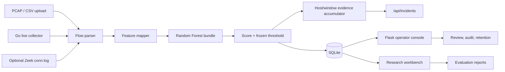

<div align="center">


<a href="https://github.com/coderv1304/network-anomaly-detection">
  
</a>

<br/>


<br/>


<br/><br/>

<a href="http://localhost:5000">🖥️ Console</a> •
<a href="http://localhost:5000/research">🔬 Research Workbench</a> •
<a href="docs/MODEL_CARD.md">🧠 Model Card</a> •
<a href="docs/CLAIM_EVIDENCE_MATRIX.md">📋 Claim Matrix</a> •
<a href="docs/PHASE_STATUS.md">📌 Phase Status</a>

</div>

---

## 🛡️ About NetShield

**NetShield** is an end-to-end network-flow analysis application that scores traffic for volumetric and scanning behavior using a Random Forest model trained on CIC-IDS-2017.

It is built to explore the gap between strong benchmark numbers and useful monitoring: leakage, class imbalance, dataset quality, and feature mismatch between offline flow exports and live capture. The project ships a Flask operator console, a research workbench, batch PCAP/CSV analysis, an optional Go capture collector, and reproducible evaluation tooling.

| | |
|---|---|
| 🎯 Project Type | Research prototype / engineering portfolio project |
| 🧪 Detection Scope | Flow-based volumetric and scanning behavior only |
| 📊 Primary Dataset | CIC-IDS-2017 (day-based split) |
| 🌍 Transfer Datasets | CIC-IDS-2018, UNSW-NB15 (negative transfer, documented) |
| 🤖 Serving Model | Random Forest, 80 statistical flow features |
| 🔑 Serving Artifact | `models/model_bundle_rf_day_based_seed42.pkl` |
| 🔒 Artifact SHA-256 | `fa4c78a38b9ae6e596df37708107a0c1c727b38a774243bbc24318860ae01350` |
| ⚖️ Decision Rule | `1 - P(BENIGN) >= 0.002515048908954043` |
| 🖥️ Console Stack | Flask • Flask-SocketIO • SQLite • Chart.js |
| 📦 Capture Stack | Go collector • Python PCAP parser • optional Npcap/libpcap |
| 🚀 Ops Surface | Docker • Prometheus/Grafana • GitHub Actions security gates |
| 📍 Status | Research prototype • not production-ready |

> **Frozen scope (P0):** NetShield is a flow-based detector for volumetric and scanning behavior. It is **not** a general NIDS. Live accuracy is unvalidated. Botnet, web attacks, infiltration, zero-day, and blocking are out of scope. Every public claim maps to an artifact in the [claim–evidence matrix](docs/CLAIM_EVIDENCE_MATRIX.md).
>
> **IDS/IPS:** the [roadmap](docs/IDS_IPS_ROADMAP.md) is a planning document, not current capability. The repository does not implement inline enforcement or traffic blocking.

---

## 🧰 Tech Stack & Tools

### Core Application

<p>

</p>

### Machine Learning & Data

<p>

</p>

### Capture, Deployment & Observability

<p>

</p>

**Also used:** pytest • Bandit • pip-audit • Trivy • SHAP • Alembic • Gunicorn • Ruff

---

## 🏗️ Architecture



**Two runnable surfaces:**

- **Operator console** (`/`) — live flow queue, filters, sensor identity, ingestion topology, collector fleet health, host/window incident triage, threat context, review workflow, alert-budget status, provenance, and audit trail.
- **Research workbench** (`/research`) — evaluation reports, threshold policy, prevalence analysis, calibration, cost model, and cross-dataset results.

**Optional capture path:** the Go collector can stream live flow records when a capture driver and interface are configured. Live accuracy is **not validated**; the console is the primary runnable surface.

**Capture vectors, not consumer network modes:** adapters and PCAP link types are classified as `ethernet`, `wlan`, `wwan`, `vpn`, `virtual`, `loopback`, or `unknown`. The vector is a name/link-type heuristic and does not change the model input. Wi-Fi, cellular, Ethernet, and VPN are never claimed as extra detection capability. See [SOC_CONTEXT.md](docs/SOC_CONTEXT.md).

---

## 📊 Evidence Snapshot

All numbers below are from the frozen evaluation protocol or from explicitly labelled research/sensitivity runs. They are development evidence, not a blind confirmatory test, and they are reported with their limitations.

| Evaluation | Result | Reading |
| --- | --- | --- |
| Serving model | RF, day-based split, seed 42, 80 features | Monday–Tuesday train, Wednesday validation, Thursday–Friday test |
| Test partition | 1,162,065 flows, 291,139 positives (25.05%) | Benchmark prevalence is high; real networks are far sparser |
| Seed-42 test | PR-AUC **0.7900**, ROC-AUC **0.7816** | Strong on the benchmark split |
| Seed-42 operating point | FPR **0.725%**, recall **57.94%**, precision **96.39%** | At a **15.06%** alert rate |
| Five-seed variation | PR-AUC **0.7472 ± 0.0749**, FPR **4.11% ± 3.27%**, recall **58.30% ± 14.79%** | The threshold does not transfer cleanly across seeds |
| Prevalence 0.1% (seed 42) | PPV **7.40%**, **78.27** alerts per 10k flows | Precision collapses outside the benchmark base rate |
| CIC-IDS-2018 transfer | ROC-AUC **0.7241**, AP **0.2048** | Frozen threshold emits **0 alerts** |
| UNSW-NB15 transfer | ROC-AUC **0.3793**, AP **0.1028** | Frozen threshold emits **0 alerts** |
| P3B portable-ratio (CIC-IDS-2018) | ROC-AUC **0.7785**, AP **0.2271** | Both improve, but the validation threshold saturates at **1.000000** |
| P3B portable-ratio (UNSW-NB15) | ROC-AUC **0.4956**, AP **0.1088** | AP is **0.0001** above the 10.86% prevalence; near chance |
| P3C corrected-label sensitivity | ROC-AUC **0.9988**, AP **0.9916** | Higher than P3B's **0.9859 / 0.9297**, but the release is also a re-extraction and thresholds still saturate |
| Cross-dataset conclusion | **Negative baseline / mixed candidate** | Reported, not tuned away |

> **What this does not mean:** a matching artifact hash is provenance, not detection evidence. High benchmark precision is not a production claim. See [PREVALENCE_EVAL.md](docs/PREVALENCE_EVAL.md), [CROSS_DATASET.md](docs/CROSS_DATASET.md), and [COST_MODEL_AND_RELEASE_GATE.md](docs/COST_MODEL_AND_RELEASE_GATE.md).

---

## 🚀 Quick Start

### Requirements

- Python 3.10 or newer
- Git
- Optional live capture: Npcap (Windows) or libpcap (Linux/macOS), a valid interface, and the privileges required by that driver

### Install and run

```bash
git clone https://github.com/coderv1304/network-anomaly-detection.git
cd network-anomaly-detection

python -m venv .venv
```

Activate the environment:

```powershell
# Windows PowerShell
.\.venv\Scripts\Activate.ps1
```

```bash
# Linux / macOS
source .venv/bin/activate
```

Install dependencies and launch:

```bash
python -m pip install -r requirements.txt
python app.py
```

Open:

- **Console:** [http://localhost:5000](http://localhost:5000)
- **Research workbench:** [http://localhost:5000/research](http://localhost:5000/research)
- **Batch upload:** [http://localhost:5000/upload](http://localhost:5000/upload)

Upload a CIC-IDS-2017-format CSV to explore batch analysis. Raw datasets and sample CSVs are not versioned because of size and licensing; point the app at your own local copy. Live packet capture stays disabled unless `ENABLE_LOCAL_CAPTURE=true` is explicitly set.

### Local container run

```bash
cp .env.example .env
docker compose up --build
```

The included Dockerfile and Compose file are for a **loopback-bound local demo**, not a production deployment. The container runs as a non-root user and does not receive packet-capture capabilities. Do not mount customer data or expose this configuration publicly.

### Optional integrations

Settings can be exported in the shell or placed in a gitignored `.env` (copied from `.env.example`); the app loads it at startup with `override=False`, so real environment variables win. Never commit a key.

| Setting | Purpose |
| --- | --- |
| `ABUSEIPDB_API_KEY` | Optional reputation lookups for eligible public IPs |
| `ENABLE_LOCAL_CAPTURE` | Enables the local packet-capture adapter |
| `NETSHIELD_CAPTURE_INTERFACE` | Selects the capture interface |
| `NETSHIELD_DEMO_STREAM` | Emits synthetic fixtures for demos only |
| `AUTH_REQUIRED` | Enables authentication and the production artifact gate |
| `ENABLE_MULTI_SIGNAL_EVIDENCE` | Enables host/window incident accumulation during ingest (default `true`) |
| `NETSHIELD_EVIDENCE_WINDOW_SECONDS` | Evidence window length (default `300`) |
| `NETSHIELD_INCIDENT_RISK_THRESHOLD` | Points needed to open an incident (default `70`) |
| `NETSHIELD_THREAT_INTEL_ON_INGEST` | Allows AbuseIPDB lookups during ingest (default `false`) |
| `NETSHIELD_THREAT_INTEL_ENABLED` | Master switch for reputation lookups; also requires `ABUSEIPDB_API_KEY` (default `false`) |
| `NETSHIELD_GEOIP_CITY_DB` / `NETSHIELD_GEOIP_ASN_DB` | Optional operator-supplied MaxMind GeoLite2 databases (no database is bundled) |
| `SENSOR_OFFLINE_SECONDS` | Heartbeat age after which a probe is `stale` (default `90`) |
| `NETSHIELD_SOAR_ENABLED` | Enables the opt-in incident webhook (default `false`) |
| `NETSHIELD_SOAR_WEBHOOK_URL` | Webhook destination; requires an allowlist match |
| `NETSHIELD_SOAR_WEBHOOK_ALLOWLIST` | Comma-separated exact hosts permitted to receive webhook payloads |

Full configuration and operational notes: [SOC_CONTEXT.md](docs/SOC_CONTEXT.md), [ENTERPRISE_READINESS_REVIEW.md](docs/ENTERPRISE_READINESS_REVIEW.md), [LIVE_CAPTURE_OPERATIONS.md](docs/LIVE_CAPTURE_OPERATIONS.md), [MULTI_SIGNAL_EVIDENCE.md](docs/MULTI_SIGNAL_EVIDENCE.md), and [OPERATIONS_RUNBOOK.md](docs/OPERATIONS_RUNBOOK.md).

---

## 🧪 Testing

```bash
# Python suite
python -m pytest tests -q

# Go collector
cd capture
go test ./...
cd ..

# Repository security gates
python scripts/secret_scan.py
python scripts/deployment_check.py
```

The CI workflow in `.github/workflows/security.yml` runs the Python suite, a secret scan, the model registry/deployment gate, `pip-audit`, a Docker build, a Trivy image scan, and the S8 release gate.

---

## 📁 Repository Map

```text
network-anomaly-detection/
├── app.py                     # Flask app: console, research workbench, API
├── evidence_accumulator.py    # Host/window multi-signal incident logic
├── live_capture.py            # Optional Python capture adapter
├── pcap_parser.py             # PCAP/CSV flow parsing
├── zeek_parser.py             # Optional Zeek conn.log parser/converter
├── feature_mapper.py          # Schema mapping to the model feature order
├── models/                    # Serving bundle, registry, metrics, manifests
├── training/                  # Training, audit, benchmark, SHAP pipelines
├── scripts/                   # Evaluation, gates, drift, release tooling
├── monitoring/                # Prometheus metrics and Grafana dashboard
├── capture/                   # Go live-capture collector
├── extension/                 # Browser extension prototype
├── templates/ static/         # Operator console and workbench UI
├── tests/                     # Python and frontend tests
├── docs/                      # Protocols, reports, runbooks, claim matrix
├── deploy/ migrations/        # Deployment and database migration assets
└── .github/workflows/         # CI security and test workflow
```

Model artifacts are local or registry-managed. The serving bundle and registry are included so a clone can reproduce the documented operating point; larger per-seed experiment bundles are regenerable and gitignored. See [models/README.md](models/README.md).

---

## 📚 Documentation

| Area | Document |
| --- | --- |
| Scope and claims | [SCOPE_AND_CLAIMS.md](docs/SCOPE_AND_CLAIMS.md) • [CLAIM_EVIDENCE_MATRIX.md](docs/CLAIM_EVIDENCE_MATRIX.md) |
| Model and evaluation | [MODEL_CARD.md](docs/MODEL_CARD.md) • [EVALUATION_PROTOCOL_V2.md](docs/EVALUATION_PROTOCOL_V2.md) |
| Benchmarks | [BENCHMARK_RESULTS.md](docs/BENCHMARK_RESULTS.md) • [BASELINE_RESULTS_V2.md](docs/BASELINE_RESULTS_V2.md) |
| Prevalence and cost | [PREVALENCE_EVAL.md](docs/PREVALENCE_EVAL.md) • [COST_MODEL_AND_RELEASE_GATE.md](docs/COST_MODEL_AND_RELEASE_GATE.md) |
| Cross-dataset transfer | [CROSS_DATASET.md](docs/CROSS_DATASET.md) • [CROSS_DATASET_MAPPING.md](docs/CROSS_DATASET_MAPPING.md) |
| Research candidates | [PORTABLE_TRANSFER.md](docs/PORTABLE_TRANSFER.md) • [CORRECTED_LABEL_SENSITIVITY.md](docs/CORRECTED_LABEL_SENSITIVITY.md) • [MULTI_SIGNAL_EVIDENCE.md](docs/MULTI_SIGNAL_EVIDENCE.md) • [WINDOW_INCIDENT_EVAL.md](docs/WINDOW_INCIDENT_EVAL.md) |
| Optional collection | [ZEEK_COLLECTOR.md](docs/ZEEK_COLLECTOR.md) |
| Features and labels | [PORTABLE_FEATURES.md](docs/PORTABLE_FEATURES.md) • [LABEL_POLICY.md](docs/LABEL_POLICY.md) |
| Dataset audits | [DISTRINET_CICIDS2017_AUDIT.md](docs/DISTRINET_CICIDS2017_AUDIT.md) • [EXTERNAL_DATASET_AUDIT.md](docs/EXTERNAL_DATASET_AUDIT.md) |
| Operations | [OPERATIONS_RUNBOOK.md](docs/OPERATIONS_RUNBOOK.md) • [INCIDENT_RESPONSE.md](docs/INCIDENT_RESPONSE.md) |
| Security | [SECURITY_AND_COMPLIANCE.md](docs/SECURITY_AND_COMPLIANCE.md) • [PRODUCT_BOUNDARY_AND_THREAT_MODEL.md](docs/PRODUCT_BOUNDARY_AND_THREAT_MODEL.md) |
| Tenancy and access | [TENANCY_AND_ACCESS_CONTROL.md](docs/TENANCY_AND_ACCESS_CONTROL.md) |
| Phase status | [PHASE_STATUS.md](docs/PHASE_STATUS.md) |
| IDS/IPS roadmap | [IDS_IPS_ROADMAP.md](docs/IDS_IPS_ROADMAP.md) — **planned, not implemented** |

---

## ⚠️ Limitations and Responsible Use

- **Not a general NIDS.** The frozen scope is volumetric and scanning behavior. Botnet, web attacks, infiltration, zero-day, and arbitrary novel attacks are out of scope.
- **Live accuracy is unvalidated.** Offline benchmark results do not transfer automatically to live capture, and the live BPF path drops ICMP and IPv6 while the upload path keeps them.
- **Benchmark prevalence is unrealistic.** At 25.05% positives the model looks strong; at 0.1% prevalence precision falls sharply.
- **Cross-dataset transfer is negative.** CIC-IDS-2018 and UNSW-NB15 do not reproduce the CIC-IDS-2017 operating point. The frozen threshold emits zero alerts on both. The P3B ratio-only candidate improves ranking on both datasets, but UNSW-NB15 AP stays essentially at chance and its threshold saturates, so this is not a deployable cross-dataset detector.
- **The serving model is uncalibrated.** The console deliberately shows no confidence percentage.
- **Host/window incidents are experimental and did not pass their own gate.** Risk points are a triage heuristic, not a probability, and the in-memory store resets on restart. A labelled 300 s host/window evaluation now exists ([WINDOW_INCIDENT_EVAL.md](docs/WINDOW_INCIDENT_EVAL.md)): no Wednesday grid point reached the 0.1% benign-window false-incident target, the frozen point transferred to a 0.79% benign-window rate on Thursday-Friday, and at 0.1% flow prevalence window precision and recall were both 0.0000. Aggregation is therefore not a validated remedy, and the serving path still alerts per flow.
- **The optional Zeek parser is not validated detection.** It maps `conn.log` fields honestly but leaves per-packet maxima and exact flag counts unavailable.
- **Console labels are model predictions, not ground truth.**
- **No containment.** NetShield does not block hosts, change firewalls, or execute response actions.
- **Do not use as a production intrusion-prevention system.** Use it for education, experimentation, and controlled lab work.

---

<div align="center">

## 🤝 Let's Connect

<a href="https://github.com/coderv1304">

</a>
<a href="https://www.linkedin.com/in/varun-nair-019574400">

</a>
<a href="mailto:coderv1304@gmail.com">

</a>
<a href="https://varun-portfolio-rouge.vercel.app/">

</a>

<br/><br/>

**Flow-based detection. Reproducible evaluation. Honest results.**

*Measure the gap. Document the failure. Improve the evidence.*


</div>
