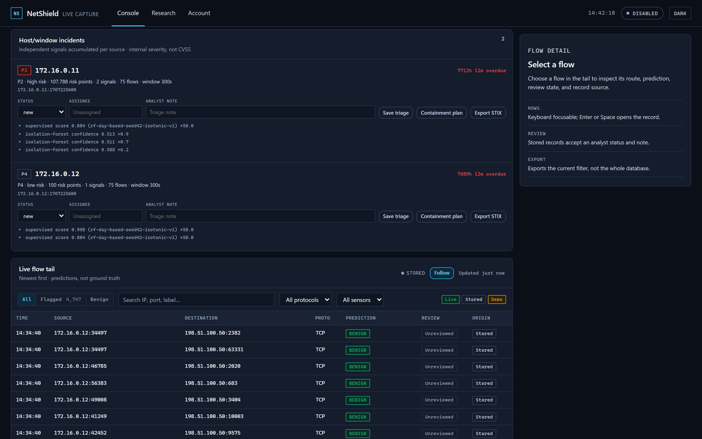
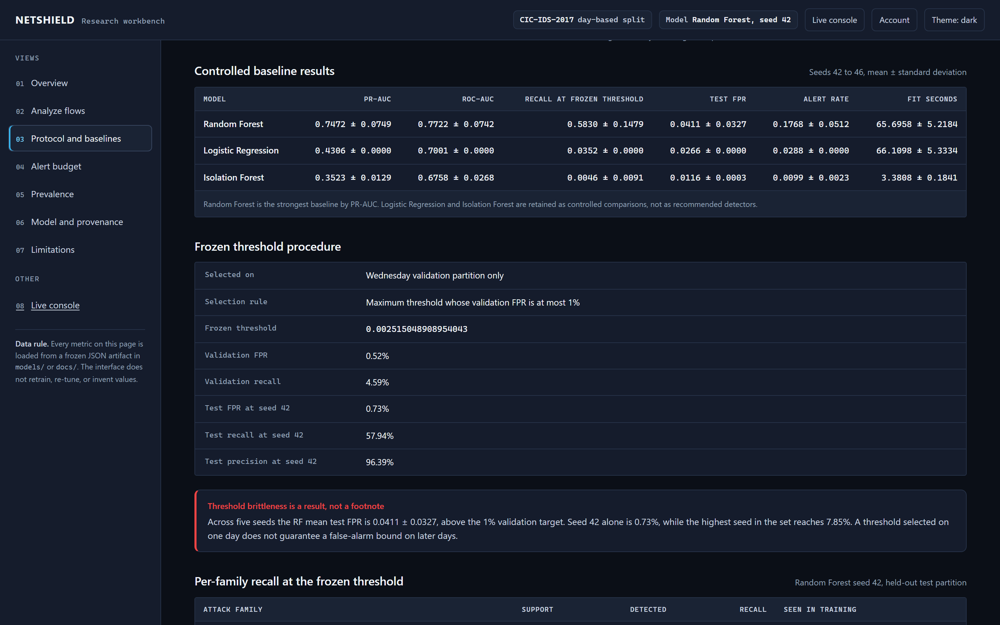
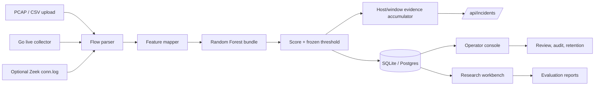

# NetShield

NetShield is a network-flow analysis application: a Flask operator console, a research workbench, batch CSV/PCAP scoring, an optional Go capture collector, and reproducible evaluation tooling. It scores flows for **volumetric and scanning behavior** with a Random Forest trained on CIC-IDS-2017.

The project measures the distance between a strong benchmark number and a usable detector: temporal leakage, class imbalance, dataset quality, prevalence collapse, and the feature mismatch between offline flow exports and live capture. Results are published with the failures intact.

**Frozen scope:** flow-based detection of volumetric and scanning traffic. NetShield is not a general NIDS, does not block traffic, and has no validated live accuracy.





## One-Click Demo

```bash
python -m venv .venv
source .venv/bin/activate        # Windows: .venv\Scripts\Activate.ps1
pip install -r requirements.txt
python app.py
```

Open <http://localhost:5000> and click **Load 500-Flow Sample**. No dataset download is required.

The button posts to `POST /api/load-sample`, which reads `tests/fixtures/sample_flows_500.csv` through the same inference path, threshold policy, calibration artifact and `EvidenceAccumulator` as any collector ingest:

- 500 flows: 350 benign across 12 hosts, plus 75 DDoS and 75 PortScan flows from the held-out Friday captures.
- All 150 attack flows come from **two** source addresses inside **one** 300-second window.
- On the shipped bundle this produces 88 per-flow alerts and **two** host/window incidents at 100/100 risk points.
- Stored rows are tagged `provenance=bundled_sample_fixture`; the console queue and incident panel refresh in place.

The fixture is an extract of real CIC-IDS-2017 rows with only `Flow ID`, `Source IP`, `Destination IP` and `Timestamp` rewritten; every model feature is the value CICFlowMeter measured. Nothing is mocked. Rebuild and re-verify it with:

```bash
python scripts/build_sample_fixture.py --check
```

If the raw captures are absent, the builder falls back to a deterministic generator that emits the exact serving feature schema. Both paths are scored by the real bundle in the build assertion and in `tests/test_sample_fixture.py`.

Other surfaces: <http://localhost:5000/research> (frozen evaluation evidence, threshold policy, prevalence analysis) and <http://localhost:5000/upload> (batch CSV/PCAP scoring).

## Architecture



Two runnable surfaces:

- **Operator console** (`/`) — flow queue, filters, sensor identity, ingestion topology, collector fleet health, host/window incident triage, review workflow, alert-budget status, provenance, audit trail.
- **Research workbench** (`/research`) — evaluation reports, threshold policy, prevalence and cost analysis, calibration, cross-dataset results.

Live capture is opt-in. The upgraded Go sensor in [`capture/`](capture/README.md) supports deterministic PCAP replay and live packet-to-feature/inference flows with IPv4/IPv6/TCP/UDP/ICMP handling, exact TCP flag counts, and sharded flow processing; the optional Python adapter (`live_capture.py`, `ENABLE_LOCAL_CAPTURE=true`) remains experimental and its PyFlowMeter-based extraction does not match that parity or validation level. Offline benchmark numbers do not establish live detection efficacy for either path. The console is the primary runnable surface.

## Serving Artifact

| Property | Value |
| --- | --- |
| Model | Random Forest, 80 CICFlowMeter features, multiclass (BENIGN, FTP-Patator, SSH-Patator) |
| Artifact | `models/model_bundle_rf_day_based_seed42.pkl` |
| SHA-256 | `fa4c78a38b9ae6e596df37708107a0c1c727b38a774243bbc24318860ae01350` |
| Split | Train Monday–Tuesday, validate Wednesday, test Thursday–Friday |
| Decision rule | `1 - P(BENIGN) >= 0.002515048908954043` |
| Calibration | Isotonic, fit on Wednesday, hash-bound to the serving artifact |

The registry-active bundle and its registry are committed so a clone reproduces the documented operating point. The hash match is provenance, not detection evidence.

Because the multiclass head only knows the Monday–Tuesday classes (BENIGN, FTP-Patator, SSH-Patator), Thursday–Friday DDoS and PortScan traffic is deliberately not a named class: `1 - P(BENIGN)` is used as an open-set anomaly score, so unseen volumetric and scanning classes are rejected as anomalous rather than classified as a known label.

## Evidence Snapshot

All numbers come from the frozen evaluation protocol or from explicitly labelled sensitivity runs. They are development evidence, not a blind confirmatory test.

### Serving Model on CIC-IDS-2017

| Evaluation | Result | Reading |
| --- | --- | --- |
| Test partition | 1,162,065 flows, 291,139 positives (25.05%) | Benchmark prevalence is far above any real network |
| Seed-42 ranking | PR-AUC 0.7900, ROC-AUC 0.7816 | Strong on the benchmark split |
| Seed-42 operating point | FPR 0.725%, recall 57.94%, precision 96.39% | At a 15.06% alert rate |
| Five-seed variation | PR-AUC 0.7472 ± 0.0749, FPR 4.11% ± 3.27%, recall 58.30% ± 14.79% | The threshold does not transfer across seeds |
| Prevalence 0.1% (seed 42) | PPV 7.40%, 78.27 alerts per 10k flows | Precision collapses outside the benchmark base rate |

### Cross-Dataset Transfer (Calibrated HistGradientBoosting)

Eight portable-ratio features; thresholds selected on Wednesday benign scores. External data is never used for fitting or threshold selection. Candidate B is a histogram gradient boosting classifier. Full results: [`docs/CALIBRATED_TRANSFER_RESULTS.md`](docs/CALIBRATED_TRANSFER_RESULTS.md).

| Dataset | Model | Threshold | ROC-AUC | PR-AUC | FPR | Precision | Recall | Alerts | Rows |
| --- | --- | ---: | ---: | ---: | ---: | ---: | ---: | ---: | ---: |
| CIC-IDS-2018 | Baseline (published threshold) | 1.0000 | 0.7685 | 0.1859 | 0.00000 | n/a | 0.0000 | 0 | 13,547,083 |
| CIC-IDS-2018 | **Candidate B** (HistGradientBoosting) | 0.1647 | 0.7764 | 0.2047 | **0.00280** | 0.1849 | 0.0079 | 43,078 | 13,547,083 |
| UNSW-NB15 | Baseline (published threshold) | 1.0000 | 0.4945 | 0.1145 | 0.00000 | n/a | 0.0000 | 0 | 38,627 |
| UNSW-NB15 | Candidate B (HistGradientBoosting) | 0.1647 | 0.5683 | 0.1688 | 0.00126 | 0.1731 | 0.0020 | 52 | 38,627 |
| Thursday–Friday (in-domain) | Candidate B (HistGradientBoosting) | 0.1647 | 0.8218 | 0.4464 | 0.01189 | 0.1596 | 0.0083 | 11,383 | 1,023,182 |

The published threshold saturates at **1.0000** and emits zero alerts on both external datasets. Candidate B clears that saturation at both benign-FPR targets (0.005 and 0.001) and holds a **0.28%** benign FPR on 13.5M CIC-IDS-2018 flows. A Wednesday-selected FPR guarantee does not travel across days: realized Thursday–Friday FPR is 1.19%, 2.4× the target. Natural-prevalence recall is 0.0083; at 0.1% prevalence precision is 0.001 with 119 alerts per 10,000 rows.

### Host/Window Incident Aggregation (300 s Window)

Replay of Thursday–Friday flows through `EvidenceAccumulator(scoring_mode="calibrated")` with uniform positive downsampling to 0.1% flow prevalence. Full results: [`docs/WINDOW_INCIDENT_EVAL.md`](docs/WINDOW_INCIDENT_EVAL.md).

| Alerting unit | Threshold | Alerts | PPV | Recall | Alerts per 10k flows |
| --- | ---: | ---: | ---: | ---: | ---: |
| Single flow | 0.4655 | 14,325 | 0.0000 | 0.0000 | 177.9167 |
| 300 s host/window incident | 100.0 | 372 | 0.0000 | 0.0000 | 4.6202 |

Windowing cuts alert volume by **38×** (177.92 → 4.62 per 10,000 flows) but does not rescue precision: at 0.1% prevalence both units report **PPV 0.0000**, and no malicious window opened an incident. At the natural 21.4% prevalence the window policy reaches PPV 0.0080 and recall 0.1667, at a 0.789% benign-window false-incident rate against a 0.1% target — 7.9× over budget. No Wednesday grid point met that target, so the reported operating point is a fallback and the policy is not validated.

**Read both evaluations together.** Aggregation is a real lever on alert volume and a null result on precision at low prevalence. The accumulator remains a triage view over per-flow scores, not a validated detector.

## Reproducing

```bash
make setup      # create .venv and install requirements.txt
make test       # pytest tests -q
make lint       # ruff check + node --check on both UI bundles
python scripts/secret_scan.py
python scripts/deployment_check.py
```

Go collector tests:

```bash
cd capture && go test ./... && cd ..
```

Long-running evaluation runners are Windows batch wrappers under `scripts/windows/` (`run_all_baselines.bat`, `run_feedback_simulation.bat`, `run_drift_monitor.bat`, `verify_feature_parity.bat`, `run_all_experiments.bat`, `run_isolation_forest.bat`, `build_capture.bat`). Each changes to the repository root first, so they run from any directory.

CI (`.github/workflows/security.yml`) additionally runs `pip-audit`, a Docker build, a Trivy image scan, and the S8 release gate.

## Configuration

Copy `.env.example` to `.env` (gitignored) or export variables directly. Real environment variables win; never commit a key.

| Setting | Purpose |
| --- | --- |
| `ABUSEIPDB_API_KEY` | Optional reputation lookups for eligible public IPs |
| `ENABLE_LOCAL_CAPTURE` / `NETSHIELD_CAPTURE_INTERFACE` | Enable and select the local capture adapter |
| `NETSHIELD_DEMO_STREAM` | Emit synthetic demo fixtures |
| `AUTH_REQUIRED` | Enable authentication and the production artifact gate |
| `ENABLE_MULTI_SIGNAL_EVIDENCE` | Host/window accumulation during ingest (default `true`) |
| `NETSHIELD_EVIDENCE_WINDOW_SECONDS` | Evidence window length (default `300`) |
| `NETSHIELD_INCIDENT_RISK_THRESHOLD` | Points required to open an incident (default `70`) |
| `NETSHIELD_EVIDENCE_SCORING_MODE` | `calibrated` (default) or `multi_signal` |
| `NETSHIELD_THREAT_INTEL_ON_INGEST` | AbuseIPDB lookups during ingest (default `false`) |
| `NETSHIELD_SOAR_ENABLED` / `NETSHIELD_SOAR_WEBHOOK_URL` | Opt-in incident webhook; requires an allowlist match |
| `SENSOR_OFFLINE_SECONDS` | Heartbeat age before a probe is `stale` (default `90`) |

Local container demo:

```bash
cp .env.example .env
docker compose up --build
```

The Dockerfile and Compose file are loopback-bound and run as a non-root user without capture capabilities. They are not a production deployment.

## Repository Map

| Path | Contents |
| --- | --- |
| `app.py` | Flask app: console, workbench, API |
| `domain/` | Domain services (auth/MFA/OIDC, incidents, evidence, SOAR, intel, sensor fleet, capture metadata, Zeek/runtime helpers) |
| `live_capture.py` | Optional Python PyFlowMeter capture adapter (experimental) |
| `pcap_parser.py` | PCAP/CSV flow parsing |
| `feature_mapper.py` | Schema mapping to the model feature order |
| `models/` | Serving bundle, registry, metrics, manifests |
| `training/` | Training, audit, benchmark, SHAP pipelines, ONNX export |
| `scripts/` | Evaluation, gates, drift, release tooling |
| `scripts/windows/` | Windows batch runners |
| `monitoring/` | Prometheus metrics and Grafana dashboard |
| `capture/` | Go packet sensor and capture collector (deterministic replay, sharded flow engine, ONNX/fallback inference) |
| `templates/`, `static/` | Operator console and workbench UI |
| `tests/fixtures/` | Bundled 500-flow sample and parser fixtures |
| `docs/` | Protocols, reports, runbooks, claim matrix |
| `Makefile` | setup, run, test, lint, docker targets |
| `pyproject.toml` | Project metadata, Ruff and pytest configuration |

## Documentation

| Area | Document |
| --- | --- |
| Scope and claims | [SCOPE_AND_CLAIMS.md](docs/SCOPE_AND_CLAIMS.md), [CLAIM_EVIDENCE_MATRIX.md](docs/CLAIM_EVIDENCE_MATRIX.md) |
| Model and protocol | [MODEL_CARD.md](docs/MODEL_CARD.md), [EVALUATION_PROTOCOL_V2.md](docs/EVALUATION_PROTOCOL_V2.md) |
| Benchmarks | [BENCHMARK_RESULTS.md](docs/BENCHMARK_RESULTS.md), [BASELINE_RESULTS_V2.md](docs/BASELINE_RESULTS_V2.md) |
| Prevalence and cost | [PREVALENCE_EVAL.md](docs/PREVALENCE_EVAL.md), [COST_MODEL_AND_RELEASE_GATE.md](docs/COST_MODEL_AND_RELEASE_GATE.md) |
| Cross-dataset transfer | [CROSS_DATASET.md](docs/CROSS_DATASET.md), [CALIBRATED_TRANSFER_RESULTS.md](docs/CALIBRATED_TRANSFER_RESULTS.md) |
| Incidents | [MULTI_SIGNAL_EVIDENCE.md](docs/MULTI_SIGNAL_EVIDENCE.md), [WINDOW_INCIDENT_EVAL.md](docs/WINDOW_INCIDENT_EVAL.md) |
| Operations | [OPERATIONS_RUNBOOK.md](docs/OPERATIONS_RUNBOOK.md), [SOC_CONTEXT.md](docs/SOC_CONTEXT.md), [INCIDENT_RESPONSE.md](docs/INCIDENT_RESPONSE.md) |
| Security and tenancy | [SECURITY_AND_COMPLIANCE.md](docs/SECURITY_AND_COMPLIANCE.md), [TENANCY_AND_ACCESS_CONTROL.md](docs/TENANCY_AND_ACCESS_CONTROL.md) |
| Project status | [PHASE_STATUS.md](docs/PHASE_STATUS.md) |
| IDS/IPS roadmap | [IDS_IPS_ROADMAP.md](docs/IDS_IPS_ROADMAP.md) — planned, not implemented |

## Limitations

- **Not a general NIDS.** Botnet, web attacks, infiltration, zero-day and arbitrary novel attacks are out of scope; the multiclass head cannot emit those labels.
- **Live accuracy is unvalidated.** Offline benchmark numbers do not transfer to live capture automatically. The upload parser, optional Python live adapter, and Go capture sensor use different extraction paths and have not been validated as equivalent to CICFlowMeter ground truth on labeled live traffic.
- **Benchmark prevalence is unrealistic.** At 25.05% positives the model looks strong; at 0.1% precision falls to 7.40% (serving model) or 0.0000 (window evaluation).
- **Cross-dataset transfer is negative.** Neither external dataset reproduces the CIC-IDS-2017 operating point without a redesigned feature set and threshold policy.
- **Calibration and display.** A hash-bound isotonic calibrator is applied to the supervised signal used for host/window risk accumulation and incident gating in the default calibrated evidence mode when the calibration artifact matches. Per-flow decisions still use the frozen raw attack-score threshold (`1 - P(BENIGN)`), stored `attack_score` remains the raw model score, and the console displays accumulated risk points rather than a calibrated confidence percentage.
- **Host/window incidents are experimental.** Risk points are a triage heuristic, not a probability, and the accumulator is in-memory and resets on restart.
- **The Zeek parser is not validated detection.** It maps `conn.log` fields honestly and leaves per-packet maxima and exact flag counts unavailable.
- **No containment.** NetShield does not block hosts, change firewall rules, or execute response actions.
- **Do not use as a production intrusion-prevention system.** Use it for education, experimentation, and controlled lab work.

## License

MIT. See [LICENSE](LICENSE).
