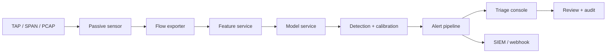
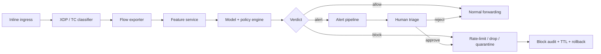
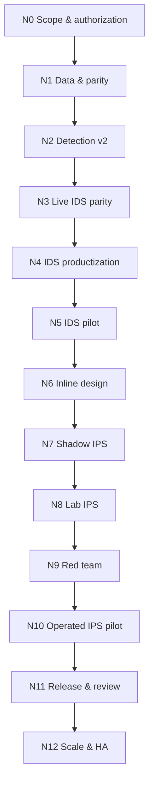

# NetShield IDS/IPS Roadmap

**Status:** planning document. **Nothing in this document is implemented.**
**Date:** 2026-11-13.
**Current product:** a passive, offline/live-capture research prototype for flow-based volumetric and scanning behavior.
**Target product:** a passive **IDS** first, then a safety-gated **IPS**.
**Rule:** a phase is complete only when its exit gate is met and the evidence is committed. A roadmap is not evidence.

---

## 0. Direct answer

### Does the scoped P2B make the project “less”?

**As a detection claim, yes — narrowly.** The original P2B target included PortScan. The CIC-IDS-2018 scoped run covers DoS and DDoS only, because CIC-IDS-2018 contains zero PortScan rows. So the new result is **less broad** than the original P2B question.

**As a project, no.** The project was never a validated PortScan detector. PortScan was a target, not evidence. The scoped run replaces an unexecutable protocol with an executable, honest one. That is a net gain in evidence quality, not a loss in capability. The correct wording is:

> “P2B now has a scoped external DoS/DDoS comparison. PortScan remains unevaluated.”

Do **not** write “P2B is complete” or “the detector covers volumetric and scanning behavior” after this run.

### What would it take to become an IDS?

An IDS is a **passive** system: it observes traffic, scores flows, raises alerts, and supports triage. NetShield already has pieces of this (capture, flow parsing, model serving, console, review workflow). The missing pieces are:

- validated live parity between offline features and live capture;
- calibrated scores and deployment-prevalence precision;
- a production alert pipeline with deduplication, suppression, and SLOs;
- an operated sensor lifecycle (enrollment, health, clock skew, backpressure);
- a pilot with human analysts and measured false-positive cost.

This is achievable, but it is **not** a one-phase change.

### What would it take to become an IPS?

An IPS is an **inline, enforcing** system: it sits in the traffic path and can drop, reset, rate-limit, or quarantine. That changes the risk category completely:

- a false positive can cause an outage;
- a false negative can be a missed attack;
- a bug in the enforcement path can partition the network;
- a bad rule can be exploited by an attacker to deny service;
- the system needs fail-open/fail-closed policy, rollback, allowlists, and change control;
- the legal and ethical exposure is materially higher than a passive monitor.

The current model is **not** safe for inline blocking. At the frozen operating point, the seed-42 test FPR is **0.725%** and recall is **57.94%**. At 0.1% attack prevalence, PPV is **7.40%** — roughly 92.6% of alerts are false. Blocking on that would be irresponsible.

**Bottom line:** NetShield can become a credible **IDS** with disciplined engineering. It can become an **IPS** only after a separate inline data plane, a policy engine, shadow-mode validation, a controlled lab, red-team testing, and an operated pilot. The roadmap below sequences that work and refuses to skip gates.

---

## 1. Current position vs IDS vs IPS

| Capability | Current state | IDS target | IPS target |
| --- | --- | --- | --- |
| Passive capture | Optional, experimental | Required, validated | Required, validated |
| Flow export | CICFlowMeter-style offline; partial live | Live parity proven | Live parity proven |
| Detection model | Research RF, uncalibrated | Calibrated, per-family, prevalence-aware | Same, plus high-precision policy layer |
| Alerting | Console + review workflow | Deduplicated, routed, SLO-bound | Same, plus verdict audit |
| Tier B fan-out | Unavailable (no raw packets) | Required for scan claims | Required |
| Inline enforcement | **None** | Not required | Required |
| Policy/allowlist | **None** | Basic suppression | Required, default-allow |
| Shadow mode | **None** | Recommended | Required before enforcement |
| HA/failover | **None** | Recommended | Required |
| Rollback | **None** | Recommended | Required |
| Live validation | **None** | Required for IDS claim | Required for IPS claim |
| External review | **None** | Recommended | Required |
| Legal/ethics review | Partial scope text | Required | Required, blocking |

---

## 2. Critical and honest analysis

### 2.1 The false-positive math is the whole IPS problem

At a 0.725% FPR, one million flows per day produce roughly **5,000–7,000 false alerts per day**, depending on the benign share. At 0.1% prevalence, PPV is **7.40%**, so most alerts are false. A passive IDS can absorb that with triage and suppression. An IPS cannot: every false block is a potential outage.

**Implication:** IPS enforcement cannot reuse the current global threshold. It needs a separate high-precision policy with allowlists, confidence tiers, rate limits, short block TTLs, and a human-approved escalation path.

### 2.2 The live-parity gap is unresolved

The serving model uses 80 offline CICFlowMeter features. The live BPF path drops ICMP and IPv6 while the upload path keeps them. Live accuracy is unvalidated. An IDS that scores live traffic with an offline feature contract is a demo, not an operated sensor.

**Implication:** Phase N1 and N3 must prove feature parity on the same packets before any IDS claim.

### 2.3 External generalization is weak

P3 found negative or partial transfer:

- CIC-IDS-2018: ROC-AUC **0.7241**, AP **0.2048**;
- UNSW-NB15: ROC-AUC **0.3793**, AP **0.1028**;
- the frozen strict threshold emits **0 alerts** on both.

**Implication:** the model is not a general detector. The IDS must be scoped, calibrated, and continuously monitored for drift.

### 2.4 The evasion gap is not addressed

The current evaluation does not test fragmentation, encryption, spoofing, slow scans, protocol tunneling, or adversarial feature manipulation. A per-flow model can be evaded by changing timing, packet sizes, or directionality.

**Implication:** Phase N9 must include adversarial and red-team testing before any IPS claim.

### 2.5 The enforcement gap is architectural

There is no inline path. The Go collector is passive. There is no eBPF/XDP, TC, netfilter, or firewall integration. Adding blocking is not a button; it is a new data plane with its own failure modes.

**Implication:** Phase N6 must design the inline sensor and enforcement boundary before code is written.

### 2.6 The operational gap is real

There is no HA, no rollback, no canary, no block audit, no on-call for enforcement, and no change-control workflow for rules. An IPS without these is a liability.

**Implication:** Phase N7 and N8 must treat safety controls as deliverables, not afterthoughts.

### 2.7 The legal and ethical gap is blocking

Blocking traffic is an active response. It can affect third parties, violate change-control policy, or create liability. The project needs a written authorization model, an acceptable-use policy, and a lab boundary.

**Implication:** Phase N0 must produce a signed scope and authorization record before any inline work.

### 2.8 What is genuinely strong

- The claim–evidence matrix and phase-status audit are unusually honest.
- The evaluation protocol, negative results, and reproducibility are solid.
- The console, review workflow, tenancy foundation, and tests are real assets.
- The project is good at **not** overclaiming. Preserve that.

### 2.9 Score discipline

The internal audit does **not** support a detection or SaaS score increase from a plan. Scores move only when evidence lands. A roadmap is not evidence.

---

## 3. Target architecture

### 3.1 IDS (passive)

### 3.2 IPS (inline, safety-gated)

### 3.3 Non-negotiable safety rules

1. **Default allow.** Unknown or low-confidence traffic is never blocked.
2. **Shadow first.** The IPS runs in observe-only mode before any enforcement.
3. **Allowlist first.** Management, backup, monitoring, and identity traffic are exempt.
4. **Short TTL.** Blocks expire automatically; no permanent blocks without human approval.
5. **Fail-open by default.** An enforcement failure must not take down the network.
6. **Every verdict is audited.** Who, what, why, model version, threshold, and rollback path.
7. **No model promotion without a passing coverage gate and calibration.**
8. **No inline deployment outside a controlled lab without sign-off.**

---

## 4. Team

| Role | Core responsibility | Required skills | Phases |
| --- | --- | --- | --- |
| Research lead / PI | Scope, estimand, gate decisions | ML evaluation, network security research | N0–N12 |
| Applied statistician | Power, CIs, prevalence, McNemar, calibration | Bootstrap, hypothesis testing, calibration | N1–N5, N9 |
| ML engineer | Detection models, calibration, drift | scikit-learn, boosting, calibration, SHAP | N1–N5, N9 |
| Data engineer | Ingestion, dedup, schema, lineage | Pandas/Polars, Parquet, DuckDB, pipelines | N1–N3 |
| Detection engineer | Rules, signatures, per-family logic | IDS rules, Suricata/Zeek concepts, Tier B | N1–N5, N9 |
| Network/packet engineer | Capture, flow export, parity | PCAP, CICFlowMeter, BPF, tcpreplay | N1, N3, N6 |
| Kernel/eBPF engineer | Inline data plane, XDP/TC | C, eBPF, XDP, TC, ring buffers | N6–N8 |
| Backend/platform engineer | API, policy, audit, tenancy | Python/Go, SQL, queues, auth | N4, N7, N8 |
| SRE / operations | HA, SLO, rollback, on-call | Kubernetes, observability, incident response | N4, N8, N10 |
| Security engineer / red team | Threat model, adversarial tests | Offensive security, evasion, pen testing | N0, N9, N11 |
| QA / test automation | Regression, chaos, replay | pytest, Go test, property tests, CI | N1–N12 |
| MLOps engineer | Registry, serving, reproducibility | Model registry, containers, hashes | N2–N5 |
| UX / technical writer | Triage UX, docs, claim language | Security UX, runbooks, honest copy | N4, N10 |
| Legal / compliance / DPO | Authorization, privacy, liability | Network law, data protection, contracts | N0, N10, N11 |
| Product manager | Scope, priorities, release gates | Roadmapping, risk trade-offs | N0–N12 |
| External reviewer / pen tester | Independent validation | IDS/IPS testing, red team | N9, N11 |

**Minimum viable team for IDS:** research lead, ML engineer, data engineer, network engineer, backend engineer, SRE, QA, technical writer. **IPS adds:** kernel/eBPF engineer, security/red team, legal/compliance, and an operated lab.

---

## 5. Phase-by-phase plan

The phases below are ordered by dependency. Do not start a phase before its entry criteria are met. Each phase has a **hard exit gate** and a concrete **implementation checklist**.

### Phase N0 — Re-scope, authorization, and claims reset

**Objective:** define what “IDS” and “IPS” mean for this project, what is explicitly out of scope, and who is authorized to enforce.

**Entry criteria:** current repository state; existing scope and claim matrix.

**Workstreams:**
- Write the IDS/IPS product boundary: passive vs inline, detection vs enforcement.
- Define the authorization model: lab-only, pilot, production.
- Write the acceptable-use and data-handling policy.
- Define the claims that may and may not be made at each phase.
- Create the phase-status table for N0–N12.

**Deliverables:**
- `docs/IDS_IPS_SCOPE_AND_AUTHORIZATION.md`
- updated `docs/CLAIM_EVIDENCE_MATRIX.md`
- updated `docs/PHASE_STATUS.md`
- a signed-off “no inline enforcement without N8 gate” rule.

**Exit gate:** named owner signs the scope; no code claims IDS/IPS capability; the roadmap is linked from the README as **planned, not implemented**.

**Honest failure mode:** treating the roadmap as a capability. Reject any copy that says “NetShield is an IPS” before N10.

**Implementation steps:**

1. Write `docs/IDS_IPS_SCOPE_AND_AUTHORIZATION.md` with definitions of passive IDS, shadow IPS, and inline IPS.
2. Record the authorized environments (lab, pilot, production) and name the approver for each.
3. List explicit non-goals, prohibited claims, and data-handling/retention rules.
4. Add the binding rule: no inline enforcement before the N8 gate.
5. Add a per-phase table of allowed and prohibited claim language.
6. Update `docs/PHASE_STATUS.md` with N0-N12 rows, all `Not started` except N0.
7. Add the `planned, not implemented` note and roadmap link to the README docs map.
8. Record owner, date, and sign-off in the document header.
9. Run the claim-matrix scope queries and confirm zero hits.

---

### Phase N1 — Data foundation, Tier B, and live parity contract

**Objective:** make the feature contract executable on live traffic and add the stateful features needed for scan claims.

**Entry criteria:** N0 signed; access to a lab capture environment; legal approval for packet capture.

**Workstreams:**
- Freeze the Tier A and Tier B feature definitions.
- Implement a stateful 60-second aggregator for fan-out features.
- Build a replay corpus from PCAP with known labels.
- Prove offline/live parity on the same packets.
- Add schema hashes and versioning for every feature set.

**Deliverables:**
- `docs/FEATURE_CONTRACT_V3.md`
- `scripts/feature_parity_v3.py`
- `tests/test_feature_parity_v3.py`
- a replay corpus manifest with hashes
- a parity report with per-feature differences.

**Exit gate:** the same PCAP produces the same feature vector within a documented tolerance in offline and live paths; Tier B features exist and are tested; ICMP/IPv6 behavior is explicit.

**Honest failure mode:** calling a flow-start timestamp a packet timestamp, or approximating fan-out from per-flow data. Reject both.

**Implementation steps:**

1. Freeze Tier A and Tier B definitions with units, directionality, timestamp semantics, and missing-value policy in `docs/FEATURE_CONTRACT_V3.md`.
2. Implement the stateful 60-second aggregator for fan-out features: unique destination ports, unique destination hosts, connection attempts, fan-out ratio.
3. Build a replay corpus manifest with SHA-256 hashes and label provenance.
4. Implement `scripts/feature_parity_v3.py` to replay one labelled PCAP through the offline and live paths.
5. Add `tests/test_feature_parity_v3.py` covering ICMP, IPv6, fragmented packets, and empty flows.
6. Run the parity harness and record per-feature deltas against a stated tolerance.
7. List exactly which features are unavailable live and why.
8. Confirm the serving artifact, threshold, and registry are unchanged.

---

### Phase N2 — Detection v2: calibrated, per-family, prevalence-aware

**Objective:** replace the single global threshold with a calibrated, per-family, budget-aware detector.

**Entry criteria:** N1 parity contract; a leakage-safe training/validation/test split with family coverage.

**Workstreams:**
- Train per-family or hierarchical models for DoS, DDoS, and PortScan.
- Calibrate scores (isotonic or Platt) on validation only.
- Select thresholds at explicit alert budgets (10, 50, 100 per 10k).
- Report PPV at 0.01%, 0.1%, 1%, and benchmark prevalence.
- Add drift monitoring and a calibration report.
- Keep the scoped external result separate from the serving model.

**Deliverables:**
- `docs/DETECTION_V2.md`
- `docs/detection_v2_results.json`
- calibrated model bundles and manifests
- `tests/test_detection_v2.py`
- a calibration and prevalence report.

**Exit gate:** every claimed family has validation and test coverage; calibration is measured; thresholds are frozen before the test pass; the serving registry is unchanged unless a separate promotion gate is approved.

**Honest failure mode:** selecting the threshold on test, or reporting benchmark precision as deployment precision. Reject both.

**Implementation steps:**

1. Freeze the protocol and the train/validation/test split; verify family coverage before fitting.
2. Train per-family or hierarchical models for DoS, DDoS, and PortScan only where coverage exists.
3. Fit calibration (isotonic or Platt) on validation data only.
4. Select thresholds on validation at 10, 50, and 100 alerts per 10,000 flows.
5. Score the test set once and compute recall, FPR, PPV at 0.01%, 0.1%, 1%, and benchmark prevalence.
6. Report confidence intervals, Brier score, and ECE per family.
7. Write `docs/detection_v2_results.json` and `docs/DETECTION_V2.md`.
8. Add `tests/test_detection_v2.py` for threshold freezing, calibration, coverage, and registry isolation.
9. Write the drift-monitoring plan with PSI/KS thresholds.

---

### Phase N3 — Live IDS parity and replay validation

**Objective:** prove the passive IDS sees the same thing offline and live.

**Entry criteria:** N1 and N2 complete; a lab mirror/TAP and a replay harness.

**Workstreams:**
- Deploy a passive sensor on a lab mirror/TAP.
- Replay labelled PCAPs at controlled rates.
- Compare live alerts with offline alerts flow-by-flow.
- Measure capture loss, backpressure, clock skew, and sensor health.
- Document every difference.

**Deliverables:**
- `docs/LIVE_IDS_PARITY.md`
- `docs/live_ids_parity.json`
- `tests/test_live_ids_parity.py`
- a sensor health dashboard and runbook.

**Exit gate:** live and offline alerts match within a documented tolerance on the replay corpus; capture loss and backpressure are measured; the report states what remains unvalidated.

**Honest failure mode:** calling a replay a real deployment. A replay is controlled evidence, not field evidence.

**Implementation steps:**

1. Deploy a passive sensor on a lab mirror or TAP with no inline path.
2. Build a replay harness that sends labelled PCAPs at controlled rates.
3. Compare live alerts against offline alerts flow by flow.
4. Measure capture loss, backpressure, clock skew, and sensor health.
5. Classify and explain every mismatch.
6. Write `docs/LIVE_IDS_PARITY.md`, `docs/live_ids_parity.json`, and `tests/test_live_ids_parity.py`.
7. Write the sensor runbook for enrollment, health, and failure modes.
8. State explicitly what remains unvalidated.

---

### Phase N4 — Passive IDS productization

**Objective:** turn the console into an operated IDS surface with alert routing, suppression, SLOs, and audit.

**Entry criteria:** N3 parity evidence; a defined pilot environment.

**Workstreams:**
- Alert deduplication, grouping, suppression, and routing.
- Sensor enrollment, health, and clock-skew handling.
- SLOs for ingest latency, alert latency, and queue health.
- Triage workflow with assignment, disposition, and audit.
- Retention and privacy controls.
- SIEM/webhook integration.

**Deliverables:**
- `docs/IDS_OPERATIONS.md`
- SLO definitions and dashboards
- `tests/test_alert_pipeline.py`
- a pilot runbook.

**Exit gate:** an analyst can triage a labelled replay end-to-end; alerts are deduplicated and routed; SLOs are measured; every disposition is audited.

**Honest failure mode:** calling a dashboard an operated IDS. Operated means someone uses it under a defined process.

**Implementation steps:**

1. Implement deterministic alert deduplication and grouping.
2. Add suppression and allowlist controls with an audit record for every change.
3. Add sensor enrollment, health checks, and clock-skew handling.
4. Define SLOs for ingest latency, alert latency, and queue health; add dashboards.
5. Build the triage workflow: assignment, disposition, and audit.
6. Add retention and privacy controls, plus SIEM/webhook routing.
7. Write `docs/IDS_OPERATIONS.md`, the pilot runbook, and `tests/test_alert_pipeline.py`.
8. Verify all UI copy stays passive and does not imply prevention.

---

### Phase N5 — IDS pilot

**Objective:** measure the IDS in a real, consented environment with human analysts.

**Entry criteria:** N4 exit gate; a partner, consent, and a data-processing agreement.

**Workstreams:**
- Deploy passive sensors on a consented network segment.
- Measure alert volume, analyst time, false-positive cost, and missed detections.
- Collect structured feedback.
- Produce a pilot outcome report, positive or negative.

**Deliverables:**
- `docs/IDS_PILOT_PROTOCOL.md`
- `docs/IDS_PILOT_OUTCOME.md`
- a de-identified dataset of alert dispositions
- an updated claim matrix.

**Exit gate:** the pilot runs for a predeclared period; the outcome is reported with limitations; no production claim is made from a single pilot.

**Honest failure mode:** a pilot with no predeclared success criteria, or a report that hides the false-positive cost.

**Implementation steps:**

1. Write and freeze `docs/IDS_PILOT_PROTOCOL.md`: site, segment, duration, consent, success criteria, stop rules.
2. Deploy passive sensors on the consented segment only.
3. Measure alert volume, analyst time, false-positive cost, and missed detections.
4. Collect structured analyst feedback.
5. Write `docs/IDS_PILOT_OUTCOME.md` including negative results and limitations.
6. Produce a de-identified disposition dataset.
7. Update the claim matrix; do not generalize beyond one site.

---

### Phase N6 — Inline sensor and enforcement design

**Objective:** design the inline data plane and enforcement boundary before writing blocking code.

**Entry criteria:** N5 pilot evidence; N0 authorization; a lab network with a safe rollback path.

**Workstreams:**
- Choose the inline hook: XDP, TC, nftables, or a bridge.
- Define fail-open/fail-closed behavior.
- Define the verdict protocol between the model/policy service and the data plane.
- Design block TTLs, rate limits, and quarantine.
- Design the allowlist and management-plane exemption.
- Model latency, throughput, and failure modes.

**Deliverables:**
- `docs/INLINE_ENFORCEMENT_DESIGN.md`
- a threat model and failure-mode analysis
- a lab topology diagram
- a rollback and kill-switch procedure.

**Exit gate:** the design is reviewed by network, kernel, SRE, and security; the fail-open path is proven on paper; no enforcement code is merged yet.

**Honest failure mode:** writing the eBPF program before the policy and rollback design. Reject it.

**Implementation steps:**

1. Choose the inline hook (XDP, TC, nftables, or bridge) and justify it against the latency/throughput budget.
2. Define the verdict protocol between the policy service and the data plane.
3. Write the fail-open/fail-closed decision record; default is fail-open.
4. Design block TTLs, rate limits, quarantine, and management-plane exemptions.
5. Write the threat model: bypass, spoofing, fragmentation, and denial of service against the IPS.
6. Document the lab topology, kill switch, and rollback procedure.
7. Run a joint review with network, kernel, SRE, security, and legal; merge no enforcement code.

---

### Phase N7 — Policy engine and shadow IPS

**Objective:** build the policy layer and run the IPS in observe-only mode.

**Entry criteria:** N6 design signed; a lab inline deployment.

**Workstreams:**
- Policy engine: allowlists, confidence tiers, TTLs, rate limits, and escalation.
- Shadow mode: emit verdicts without enforcing.
- Compare shadow verdicts with analyst dispositions.
- Measure false-block candidates and near-misses.
- Build the block audit and rollback path.

**Deliverables:**
- `docs/POLICY_ENGINE.md`
- `docs/SHADOW_IPS_RESULTS.md`
- `tests/test_policy_engine.py`
- a shadow-mode dashboard.

**Exit gate:** shadow mode runs for a predeclared period; every would-be block is reviewed; the false-block rate is measured; no enforcement is enabled.

**Honest failure mode:** enabling enforcement because shadow results “look good” without a predeclared threshold.

**Implementation steps:**

1. Implement the policy engine: allowlists, confidence tiers, TTLs, rate limits, and escalation.
2. Emit verdicts in shadow mode with zero packet modification.
3. Build the block-audit schema and the rollback path.
4. Run shadow mode for the predeclared period.
5. Review every would-be block and measure false-block candidates and near-misses.
6. Write `docs/POLICY_ENGINE.md`, `docs/SHADOW_IPS_RESULTS.md`, `tests/test_policy_engine.py`, and the dashboard.
7. Confirm enforcement stays disabled.

---

### Phase N8 — Controlled lab IPS

**Objective:** enable limited enforcement in a lab, with fail-open, canary, and rollback.

**Entry criteria:** N7 shadow results; N6 design; legal and SRE sign-off.

**Workstreams:**
- Enable enforcement only for a canary segment.
- Start with rate-limit and short TTL, not permanent drop.
- Prove fail-open under process crash, policy service outage, and overload.
- Run chaos tests and rollback drills.
- Measure latency and throughput under enforcement.

**Deliverables:**
- `docs/LAB_IPS_RESULTS.md`
- chaos and rollback test results
- a canary runbook
- `tests/test_inline_enforcement.py`.

**Exit gate:** enforcement is reversible; fail-open is proven; chaos tests pass; the lab result is reported with limitations; no production claim.

**Honest failure mode:** a lab test that only exercises the happy path. Require crash, overload, and rollback tests.

**Implementation steps:**

1. Deploy a canary lab segment with enforcement disabled by default.
2. Enable only rate-limit and short-TTL blocks.
3. Run chaos tests: process crash, policy-service outage, overload, and clock skew.
4. Run rollback drills and measure recovery time.
5. Measure latency and throughput under enforcement.
6. Write `docs/LAB_IPS_RESULTS.md`, the canary runbook, and `tests/test_inline_enforcement.py`.
7. Confirm every block has a TTL and an audit record.

---

### Phase N9 — Adversarial and red-team validation

**Objective:** try to evade and attack the IDS/IPS, and fix what is fixable.

**Entry criteria:** N8 lab IPS; a rules of engagement document.

**Workstreams:**
- Evasion tests: fragmentation, encryption, spoofing, slow scans, protocol tunneling, feature manipulation.
- IPS self-protection: can an attacker induce a block or deny service?
- False-positive stress: management traffic, backups, identity, monitoring.
- Red-team report with reproducible cases.

**Deliverables:**
- `docs/ADVERSARIAL_EVALUATION.md`
- a red-team case corpus with hashes
- fixes and regression tests
- an updated threat model.

**Exit gate:** every discovered issue is fixed, accepted with a documented residual, or marked blocking; no hidden findings.

**Honest failure mode:** a red-team exercise that only tests known signatures. Require novel cases and a written rules of engagement.

**Implementation steps:**

1. Write the rules of engagement and the lab-only scope.
2. Build evasion cases: fragmentation, encryption, spoofing, slow scans, protocol tunneling, feature manipulation.
3. Test IPS self-protection: can an attacker induce a block or deny service?
4. Stress false positives with management, backup, identity, and monitoring traffic.
5. Reproduce every case and hash the corpus.
6. Fix each confirmed issue or record a documented residual; add regression tests.
7. Write `docs/ADVERSARIAL_EVALUATION.md` and update the threat model.

---

### Phase N10 — Operated IPS pilot

**Objective:** operate the IPS with real traffic under strict safety controls.

**Entry criteria:** N8 and N9 exit gates; a partner, consent, legal approval, and a rollback plan.

**Workstreams:**
- Deploy inline on a consented segment with a canary.
- Start in alert-only, then rate-limit, then short-TTL block.
- Measure false blocks, outages, analyst interventions, and rollback events.
- Maintain a 24/7 escalation path.
- Produce a pilot outcome report.

**Deliverables:**
- `docs/IPS_PILOT_PROTOCOL.md`
- `docs/IPS_PILOT_OUTCOME.md`
- an incident and rollback log
- an updated claim matrix.

**Exit gate:** the pilot meets predeclared safety criteria; no unresolved critical finding; the outcome is reported with limitations; production readiness is still not claimed.

**Honest failure mode:** a pilot that expands scope mid-run or hides a rollback event.

**Implementation steps:**

1. Write and freeze `docs/IPS_PILOT_PROTOCOL.md`: segment, canary, stages, safety criteria, stop rules, rollback.
2. Start in alert-only, then rate-limit, then short-TTL block.
3. Measure false blocks, outages, analyst interventions, and rollback events.
4. Maintain a 24/7 escalation path.
5. Log every incident and rollback.
6. Write `docs/IPS_PILOT_OUTCOME.md` with costs and limitations.
7. Update the claim matrix; do not claim production readiness.

---

### Phase N11 — Release, compliance, and external review

**Objective:** decide whether the evidence supports an IDS release, an IPS release, or neither.

**Entry criteria:** N5 (IDS) or N10 (IPS); all critical findings closed.

**Workstreams:**
- External review of the detection and enforcement evidence.
- Security and privacy compliance review.
- Release gate: claims, hashes, SBOM, vulnerability scan, rollback plan.
- Publish an honest release note with limitations.

**Deliverables:**
- `docs/RELEASE_EVIDENCE.md`
- an external review report
- a release gate result
- an updated claim matrix.

**Exit gate:** the release gate passes; every public claim maps to evidence; the release note states the scope and limitations.

**Honest failure mode:** a release gate that passes because the evidence was weakened, not because the system improved.

**Implementation steps:**

1. Assemble release evidence: claims, artifacts, hashes, test results, SBOM, and vulnerability scan.
2. Commission an external review of the detection and enforcement evidence.
3. Run the release gate and record pass/fail per criterion.
4. Publish an honest release note with scope and limitations.
5. Update the claim matrix so every public claim maps to an artifact.
6. Block release on any open critical finding.

---

### Phase N12 — Scale, HA, and continuous operations

**Objective:** make the IDS/IPS operable at scale without silently degrading safety.

**Entry criteria:** N11 release; an operated environment.

**Workstreams:**
- Horizontal scale for sensors and model serving.
- HA and failover for the inline path.
- Backpressure and loss budgets.
- Continuous drift and calibration monitoring.
- On-call, incident response, and rollback drills.
- Cost and capacity planning.

**Deliverables:**
- `docs/SCALE_AND_HA.md`
- load and failover test results
- an on-call runbook
- a drift and calibration dashboard.

**Exit gate:** measured capacity, failover, and loss budgets; no silent degradation; rollback drills pass.

**Honest failure mode:** scaling the model but not the safety controls.

**Implementation steps:**

1. Build the capacity model and horizontal scaling plan for sensors and model serving.
2. Design HA and failover for the inline path.
3. Define backpressure and loss budgets.
4. Run load and failover tests; record measured capacity.
5. Add drift and calibration monitoring with alert thresholds.
6. Write the on-call runbook and rollback drill schedule.
7. Write `docs/SCALE_AND_HA.md`.

---

## 6. Phase dependency graph

**Critical path:** N0 → N1 → N2 → N3 → N4 → N5 → N6 → N7 → N8 → N9 → N10 → N11 → N12.

**Do not parallelize across a gate.** A phase may start only when its predecessor’s exit gate is met.

---

## 7. What “done” means at each level

| Level | Minimum evidence | Allowed claim |
| --- | --- | --- |
| Research prototype | Offline evaluation, hashes, tests | “Research prototype; live accuracy unvalidated.” |
| Passive IDS | N1–N4 plus a replay parity report | “Passive IDS prototype; validated on a replay corpus; not field-validated.” |
| Piloted IDS | N5 outcome with consent and measured costs | “Piloted passive IDS on one consented segment; results are site-specific.” |
| Shadow IPS | N7 shadow report with reviewed would-be blocks | “Shadow-mode IPS; no enforcement.” |
| Lab IPS | N8 chaos and rollback evidence | “Lab-only IPS with fail-open and short-TTL blocks.” |
| Operated IPS | N9 and N10 evidence plus N11 release gate | “Operated IPS on a consented segment; scoped and reversible.” |
| Production IPS | N12 plus external review and continuous operations | Only after all gates, with a named owner and rollback plan. |

---

## 8. Honest risks that do not disappear

| Risk | Why it remains | Mitigation |
| --- | --- | --- |
| False positives cause outages | Any detector has false positives; blocking amplifies the cost. | Default allow, allowlists, short TTL, shadow mode, rollback. |
| Evasion | Per-flow features are easy to perturb. | Tier B, adversarial testing, defense in depth. |
| Encrypted traffic | Flow features lose payload signal. | Scope limits, metadata-only claims. |
| Model drift | Traffic changes; calibration decays. | Continuous monitoring, recalibration, drift gates. |
| Adversarial blocking | An attacker can try to induce blocks. | Rate limits, allowlists, human approval for high-impact actions. |
| Legal liability | Blocking third-party traffic has consequences. | Authorization, consent, legal review, lab boundary. |
| Operational complexity | HA, failover, and rollback are hard. | SRE ownership, chaos tests, runbooks. |
| Claim drift | Pressure to overclaim is constant. | Claim matrix, release gate, external review. |

---

## 9. Final recommendation

1. **Do not call the current project an IDS or IPS.** It is a passive research prototype.
2. **Keep the scoped P2B result.** It is narrower than the original target, but it is executable and honest. State the PortScan gap explicitly.
3. **Build the IDS first.** N0–N5 are a credible path to a passive IDS with measured evidence.
4. **Treat the IPS as a separate safety-critical program.** N6–N12 are not a sprint; they are a gated engineering program.
5. **Do not reuse the current global threshold for blocking.** A 0.725% FPR is acceptable for triage, not for enforcement.
6. **Preserve the honesty.** The project’s strongest asset is that it documents failure. An IPS will test that discipline harder than any phase so far.

---

## 10. Document control

| Item | Value |
| --- | --- |
| Owner | NetShield maintainers |
| Status | Planning; not implemented |
| Review cadence | At every phase gate |
| Change rule | Any claim change updates the claim–evidence matrix in the same change |
| Prohibited | Claiming IDS/IPS capability without the corresponding gate |
