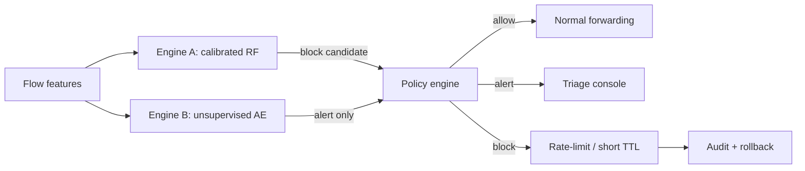
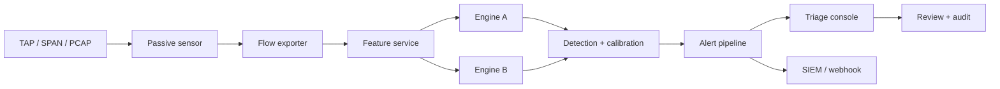
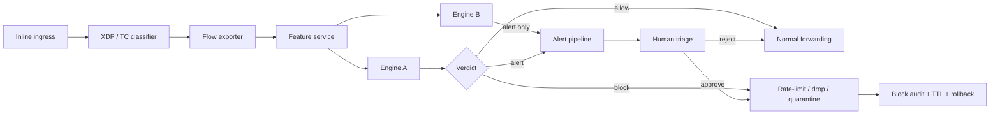
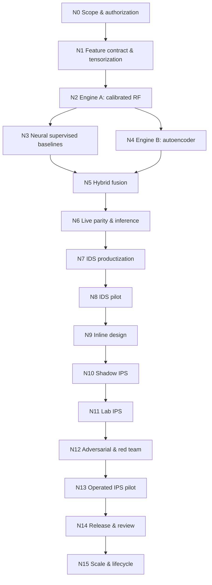

# NetShield IDS/IPS Roadmap (Neural Hybrid Edition)

**Status:** planning document. **Nothing in this document is implemented.**
**Date:** 2026-11-13.
**Current product:** a passive, offline/live-capture research prototype for flow-based volumetric and scanning behavior.
**Target product:** a passive **IDS** first, then a safety-gated **IPS**, with a calibrated tree engine as the primary blocker and an unsupervised neural engine as a shadow detector.
**Rule:** a phase is complete only when its exit gate is met and the evidence is committed. A roadmap is not evidence.

---

## 0. Direct answer

### Does adding neural networks make the IPS "actually good"?

**No, not by itself.** An IPS is good when it has low false blocks, low latency, live parity, rollback, and an operated policy. Model architecture is one input to that. The current project's blocking blockers are calibration, live parity, policy, and operations — not the absence of a neural network.

### What the neural work should be

Use the hypothesis in the brief, and test it rather than assume it:

- **Engine A — calibrated Random Forest.** Fast, explainable, primary inline blocker for known volumetric and scanning signatures.
- **Engine B — unsupervised autoencoder.** Shadow and alerting only. Test whether reconstruction-error anomaly detection catches the cross-dataset attacks that Engine A misses.
- **Supervised neural baselines — MLP, FT-Transformer, and a tabular ResNet.** Research comparators, not candidates for promotion by default. Their job is to produce an honest negative or positive result against Engine A.
- **Hybrid architecture.** Engine A blocks; Engine B alerts; a fusion policy decides what reaches an analyst. Engine B never blocks until it passes the same gates as Engine A, and probably never should.

### Why this is the stronger thesis

A thesis that says "we replaced the tree with a neural network and it was better" is weak on tabular flow data and usually false. A thesis that says:

> "On tabular flow features, a calibrated Random Forest matches or beats a supervised MLP/ResNet on PR-AUC and p99 latency, while an unsupervised autoencoder recovers part of the cross-dataset recall the supervised engine loses — and the hybrid is the deployable answer"

is stronger, more honest, and more useful. It also matches the evidence already in this repository: the P3 transfer is negative, and the scoped P2B result is mixed.

### The P2B result that changes the order of work

The scoped CIC-IDS-2018 run (11,717,527 unique rows, group split 70/15/15, five seeds) found:

- logistic regression: **10.12% recall at 0.16% FPR** at 100 alerts/10k;
- Random Forest seed 42: **0.02% recall** at 0.00% FPR;
- Isolation Forest: near-random, ROC-AUC **0.49**.

The RF number is not a fair test of the model. Its uncalibrated validation scores saturate at **0.9999996753**, so the 10-alert and 100-alert budgets select the **same threshold**, and almost nothing clears it on test. That is a calibration and threshold-selection failure, not evidence that trees are bad. **Fix Engine A before comparing it to any neural network.** Otherwise the comparison is rigged against the baseline.

---

## 1. Research questions and falsification criteria

Pre-register these before N2. A negative answer is a valid result and must be published.

| ID | Hypothesis | Falsified if |
| --- | --- | --- |
| H1 | A calibrated RF (Engine A) matches or beats supervised MLP/FT-Transformer/ResNet on tabular PR-AUC and p99 batch-1 latency. | A neural model beats RF by ≥2 PR-AUC points with non-overlapping CIs across 5 seeds **and** has p99 latency ≤ RF. |
| H2 | The unsupervised autoencoder (Engine B) improves cross-dataset recall at a fixed 100-alert/10k budget versus Engine A alone. | The recall delta is ≤0 or its CI crosses 0 on both CIC-IDS-2018 and UNSW-NB15. |
| H3 | Hybrid A+B improves recall without more than doubling alert volume. | Alert volume >2× or precision drops >5 points at the same budget. |
| H4 | Engine B remains stable under drift for four weeks. | PSI >0.2 on any monitored feature, or recall drops >20% relative. |
| H5 | Neural models are more vulnerable to feature perturbation than RF. | Neural evasion rate ≤ RF evasion rate under the same perturbation budget. |

**Interpretation rule:** H1 false is fine. H2 false is a publishable negative result. H3 false means the hybrid is dropped. H4 false means Engine B stays shadow-only. H5 true means no neural model goes inline.

---

## 2. Current position vs target

| Capability | Current state | IDS target | IPS target |
| --- | --- | --- | --- |
| Passive capture | Optional, experimental | Required, validated | Required, validated |
| Flow export | Offline CICFlowMeter-style; partial live | Live parity proven | Live parity proven |
| Engine A | Uncalibrated RF, global threshold | Calibrated, per-family, budget-aware | Same, plus policy |
| Engine B | None | Unsupervised AE in shadow | Alert-only, never blocking |
| Neural baselines | None | MLP / FT-Transformer / ResNet compared honestly | Same |
| Alerting | Console + review workflow | Deduplicated, routed, SLO-bound | Same, plus verdict audit |
| Tier B fan-out | Unavailable | Required for scan claims | Required |
| Inline enforcement | **None** | Not required | Required |
| Policy/allowlist | **None** | Basic suppression | Required, default-allow |
| Shadow mode | **None** | Recommended | Required before enforcement |
| HA/failover | **None** | Recommended | Required |
| Rollback | **None** | Recommended | Required |
| Live validation | **None** | Required for IDS claim | Required for IPS claim |
| External review | **None** | Recommended | Required |
| Legal/ethics review | Partial scope text | Required | Required, blocking |

---

## 3. Critical and honest analysis

### 3.1 Tabular neural networks are not automatically better

Flow features are tabular, heterogeneous, and often heavy-tailed. Gradient-boosted trees and Random Forests are strong baselines on this shape of data. An MLP can match them with careful tuning; a ResNet or FT-Transformer can be competitive but is heavier and harder to explain. Expect H1 to fail. Design the study so that failure is a result, not an embarrassment.

### 3.2 The P2B RF result is a calibration bug, not a model verdict

The RF threshold is `0.9999996753` at both 10 and 100 alerts/10k. Saturated probabilities collapse the budget boundary. The first fix is calibration (isotonic or Platt on validation), then a tie-aware threshold rule. Only after that does a neural comparison mean anything.

### 3.3 Autoencoders are not magic anomaly detectors

An autoencoder trained on benign traffic can reconstruct common attacks well, especially volumetric attacks that look like heavy but ordinary traffic. It can also flag rare benign traffic. Reconstruction error is not a probability, and its threshold is unstable. Evaluate at a fixed alert budget, not at a hand-picked error threshold.

### 3.4 Cross-dataset feature availability limits Engine B

CIC-IDS-2018 supplies all 12 Tier A features. UNSW-NB15 supplies 8 of 12. An autoencoder trained on 80 CICFlowMeter features cannot score UNSW without a common subset. The cross-dataset experiment must train and score on the **common feature subset**, and the report must say so. Otherwise the comparison is invalid.

### 3.5 The "0 alerts" baseline is a threshold artifact

P3's frozen strict threshold emits zero alerts on both external datasets, but at a 100-alert/10k rank budget the same model reaches 2.34% recall on CIC-2018 and 0.73% on UNSW. Engine B must be compared at the **same rank budget**, not against a threshold that was never designed for external data.

### 3.6 Latency is an IPS constraint, not a benchmark detail

A small autoencoder is cheap; a ResNet or Transformer at batch size 1 may not be. Measure p50/p95/p99 at batch 1 on the target CPU, with feature extraction included. A model that wins PR-AUC but misses the latency budget is not deployable inline.

### 3.7 Neural models are easier to evade

Per-flow features are easy to perturb: timing, packet sizes, directionality, and flag counts. Neural models add gradient-friendly surfaces. Engine B must be tested against feature perturbation and poisoning; Engine A must be tested too, but the neural engine needs its own adversarial gate.

### 3.8 Explainability decides analyst trust

Engine A can expose feature contributions. Engine B can expose per-feature reconstruction error, which is weaker. If analysts cannot understand why an alert fired, they will suppress it. Budget for explainability, not just accuracy.

### 3.9 Label contamination is a silent failure

"Benign" traffic can contain unlabeled attacks. An autoencoder trained on contaminated benign data learns to reconstruct attacks. Use confident-benign filtering, report the filter, and test sensitivity to contamination.

### 3.10 Hybrid systems double the failure modes

Two engines mean two thresholds, two drift surfaces, two alert sources, and a fusion policy that can create alert storms. Engine B stays in shadow until it beats the pre-registered gates, and the fusion policy must be default-quiet.

### 3.11 The enforcement gap is architectural

There is no inline path. The Go collector is passive. There is no eBPF/XDP, TC, netfilter, or firewall integration. Adding blocking is a new data plane with its own failure modes.

### 3.12 The operational and legal gaps remain blocking

There is no HA, no rollback, no canary, no block audit, and no on-call for enforcement. Blocking traffic is an active response with legal exposure. N0 authorization and N11/N13 human gates are not optional.

### 3.13 What is genuinely strong

- The claim–evidence matrix and phase-status audit are unusually honest.
- The evaluation protocol, negative results, and reproducibility are solid.
- The console, review workflow, tenancy foundation, and tests are real assets.
- The project is good at **not** overclaiming. Preserve that.

---

## 4. Target architecture

### 4.1 Detection engines

### 4.2 IDS (passive)

### 4.3 IPS (inline, safety-gated)

### 4.4 Non-negotiable safety rules

1. **Default allow.** Unknown or low-confidence traffic is never blocked.
2. **Engine B never blocks.** It is shadow or alert-only.
3. **Shadow first.** The IPS runs in observe-only mode before any enforcement.
4. **Allowlist first.** Management, backup, monitoring, and identity traffic are exempt.
5. **Short TTL.** Blocks expire automatically; no permanent blocks without human approval.
6. **Fail-open by default.** An enforcement failure must not take down the network.
7. **Every verdict is audited.** Who, what, why, model version, threshold, and rollback path.
8. **No promotion without a passing coverage gate and calibration.**
9. **No inline deployment outside a controlled lab without sign-off.**
10. **A neural model is never promoted on PR-AUC alone.** It must pass calibration, latency, drift, and adversarial gates.

---

## 5. Team

| Role | Core responsibility | Required skills | Phases |
| --- | --- | --- | --- |
| Research lead / PI | Scope, estimand, gate decisions | ML evaluation, network security research | N0–N15 |
| Applied statistician | Power, CIs, prevalence, McNemar, calibration | Bootstrap, hypothesis testing, calibration | N1–N6, N12 |
| ML engineer | Tree models, calibration, drift | scikit-learn, boosting, calibration, SHAP | N2–N6 |
| **ML research scientist** | Neural architecture, anomaly detection, thesis | PyTorch, tabular DL, autoencoders, evaluation | N3–N6, N12 |
| **Deep learning engineer** | Training, export, quantization, latency | PyTorch, ONNX, TorchScript, profiling | N3–N6, N12 |
| **Data curator** | Label audit, contamination, provenance | Data quality, dedup, licensing | N1–N4 |
| Data engineer | Ingestion, dedup, schema, lineage | Pandas/Polars, Parquet, DuckDB | N1–N2 |
| Detection engineer | Rules, signatures, per-family logic | IDS rules, Suricata/Zeek concepts, Tier B | N2–N6, N10 |
| Network/packet engineer | Capture, flow export, parity | PCAP, CICFlowMeter, BPF, tcpreplay | N1, N6, N9 |
| Kernel/eBPF engineer | Inline data plane, XDP/TC | C, eBPF, XDP, TC, ring buffers | N9–N11 |
| Backend/platform engineer | API, policy, audit, tenancy | Python/Go, SQL, queues, auth | N7, N10, N11 |
| SRE / operations | HA, SLO, rollback, on-call | Kubernetes, observability, incident response | N7, N11, N13 |
| Security engineer / red team | Threat model, adversarial tests | Offensive security, evasion, pen testing | N0, N12, N14 |
| **Adversarial ML researcher** | Evasion, poisoning, model extraction | Adversarial examples, robust ML | N12 |
| QA / test automation | Regression, chaos, replay | pytest, Go test, property tests, CI | N1–N15 |
| MLOps engineer | Registry, serving, reproducibility | Model registry, containers, hashes | N3–N6, N15 |
| UX / technical writer | Triage UX, docs, claim language | Security UX, runbooks, honest copy | N7, N13 |
| Legal / compliance / DPO | Authorization, privacy, liability | Network law, data protection, contracts | N0, N13, N14 |
| Product manager | Scope, priorities, release gates | Roadmapping, risk trade-offs | N0–N15 |
| External reviewer / pen tester | Independent validation | IDS/IPS testing, red team | N12, N14 |

**Minimum viable team for IDS:** research lead, ML engineer, ML research scientist, deep learning engineer, data curator, network engineer, backend engineer, SRE, QA, technical writer. **IPS adds:** kernel/eBPF engineer, security/red team, adversarial ML researcher, legal/compliance, and an operated lab.

---

## 6. Phase-by-phase plan

The phases below are ordered by dependency. Do not start a phase before its entry criteria are met. Each phase has a **hard exit gate** and a concrete **implementation checklist**.

### Phase N0 — Scope, authorization, and claims reset

**Objective:** define IDS and IPS for this project, the authorized environments, the prohibited claims, and the neural research boundary.

**Entry criteria:** current repository state; existing scope and claim matrix.

**Deliverables:**
- `docs/IDS_IPS_SCOPE_AND_AUTHORIZATION.md`
- updated `docs/CLAIM_EVIDENCE_MATRIX.md`
- updated `docs/PHASE_STATUS.md`
- a signed-off "no inline enforcement without N11 gate" rule
- a research-scope note for Engine A, Engine B, and the neural baselines.

**Exit gate:** named owner signs the scope; no code claims IDS/IPS capability; the roadmap is linked from the README as **planned, not implemented**; the neural research scope says Engine B never blocks.

**Honest failure mode:** treating the roadmap as a capability, or treating a neural network as an authorization to block.

**Implementation steps:**

1. Write `docs/IDS_IPS_SCOPE_AND_AUTHORIZATION.md` with definitions of passive IDS, shadow IPS, and inline IPS.
2. Record the authorized environments (lab, pilot, production) and the approver role for each.
3. List non-goals, prohibited claims, and data-handling/retention rules with owners.
4. Add the binding rule: no inline enforcement before the N11 gate.
5. Add the research boundary: Engine A may block after N11; Engine B is alert-only.
6. Add a per-phase table of allowed and prohibited claim language.
7. Update `docs/PHASE_STATUS.md` with N0–N15 rows, all `NOT_STARTED` except N0.
8. Add the `planned, not implemented` note and roadmap link to the README docs map.
9. Record owner, date, and `PENDING_HUMAN_SIGNOFF` in the document header.
10. Run the claim-matrix scope queries and confirm zero violations.

---

### Phase N1 — Feature contract, tensorization, and parity

**Objective:** make one feature contract executable on live traffic, offline replay, and neural tensorization.

**Entry criteria:** N0 signed; lab capture access; legal approval for packet capture.

**Deliverables:**
- `docs/FEATURE_CONTRACT_V3.md`
- `scripts/feature_parity_v3.py`
- `tests/test_feature_parity_v3.py`
- a replay corpus manifest with hashes
- a deterministic tensorization artifact (normalization + feature order + hash)
- a parity report with per-feature differences.

**Exit gate:** the same PCAP produces the same feature vector and the same tensor within documented tolerances; Tier B exists and is tested; ICMP/IPv6/fragment behavior is explicit; the tensorization hash is recorded.

**Honest failure mode:** calling a flow-start timestamp a packet timestamp, approximating fan-out from per-flow data, or letting training-time normalization leak into inference.

**Implementation steps:**

1. Freeze Tier A and Tier B definitions with units, directionality, timestamp semantics, and missing-value policy.
2. Define the canonical bidirectional flow key and active/idle timeouts.
3. Implement the stateful 60-second aggregator for fan-out features with a hard cardinality cap.
4. Build the replay corpus manifest with SHA-256 hashes and label provenance.
5. Implement `scripts/feature_parity_v3.py` for offline/live replay.
6. Implement deterministic tensorization: fixed feature order, fitted normalization, version hash.
7. Add tests for ICMP, IPv6, fragments, retransmissions, empty flows, and cap eviction.
8. Freeze parity tolerances before running: counts and bytes exact; rates relative ≤1e-6; timestamps ≤1 ms.
9. Report per-feature deltas and list every feature unavailable live.
10. Confirm the serving artifact, threshold, and registry are unchanged.

---

### Phase N2 — Engine A: baseline stabilization and calibrated RF

**Objective:** fix the threshold pathology exposed by the scoped P2B run and freeze a calibrated, per-family, budget-aware Engine A.

**Entry criteria:** N1 tensorization and parity; a leakage-safe group split with family coverage.

**Deliverables:**
- `docs/ENGINE_A_CALIBRATED_RF.md`
- `docs/engine_a_results.json`
- calibrated model bundle and manifest with SHA-256
- `tests/test_engine_a.py`
- a calibration report and a threshold-tie diagnostic.

**Exit gate:** calibration is measured (ECE/Brier); thresholds are stable across seeds; the tie rule is documented and tested; PPV is reported at deployment prevalence; the serving registry is unchanged unless a separate promotion gate is approved.

**Honest failure mode:** selecting the threshold on test, reporting benchmark precision as deployment precision, or hiding a tie that produces zero alerts.

**Implementation steps:**

1. Reproduce the P2B RF saturation: show the threshold is identical at 10 and 100 alerts/10k.
2. Fit isotonic and Platt calibration on validation only; compare ECE and Brier.
3. Re-select thresholds at 10, 50, and 100 alerts/10k using calibrated scores.
4. Implement and test the tie rule: smallest threshold satisfying the budget; if impossible, report `TIE_BLOCKED` without expanding the budget.
5. Train per-family or hierarchical variants for DoS, DDoS, and PortScan only where coverage exists.
6. Report recall, FPR, PPV at 0.01/0.1/1/benchmark prevalence, with Wilson or bootstrap CIs.
7. Hash the test labels before scoring; record that the test was evaluated once.
8. Write the calibration and tie diagnostics, plus a drift baseline.
9. Confirm the serving artifact, threshold, and registry are unchanged.
10. Add tests for calibration, tie handling, coverage, and registry isolation.

---

### Phase N3 — Neural supervised baselines (the honest negative comparison)

**Objective:** test H1 by comparing an MLP, an FT-Transformer, and a tabular ResNet against calibrated Engine A on the same splits, features, and budgets.

**Entry criteria:** N2 calibrated Engine A and frozen splits; a GPU or CPU budget approved for training.

**Deliverables:**
- `research/neural_baselines/` training code and configs
- `docs/NEURAL_BASELINES.md`
- `docs/neural_baselines_results.json`
- ONNX or TorchScript exports with hashes
- `tests/test_neural_baselines.py`
- a latency and calibration table.

**Exit gate:** all three neural baselines are trained with 5 seeds; results are reported against Engine A on PR-AUC, recall at fixed FPR, ECE/Brier, and p50/p95/p99 batch-1 latency; the comparison is pre-registered and the test is scored once; a negative result is published as-is.

**Honest failure mode:** tuning the neural model on test, comparing at different budgets, or omitting latency because the neural model is slower.

**Implementation steps:**

1. Freeze the comparison protocol: splits, features, budgets, metrics, seeds, latency method, and the H1 decision rule.
2. Implement the MLP with class weighting and early stopping on validation.
3. Implement the FT-Transformer with a documented tokenizer and capacity budget.
4. Implement the tabular ResNet with a documented block design.
5. Train each model with 5 seeds; log hardware, epochs, and wall time.
6. Export to ONNX or TorchScript; hash the artifacts.
7. Measure p50/p95/p99 batch-1 latency on the target CPU, including tensorization.
8. Compute PR-AUC, recall at fixed FPR, PPV at prevalence, ECE, and Brier.
9. Apply Holm correction across models and budgets.
10. Write the comparison table and the H1 verdict, positive or negative.
11. Do not promote any neural model to serving in this phase.

---

### Phase N4 — Engine B: unsupervised autoencoder

**Objective:** test H2 by training an autoencoder on confident-benign traffic and measuring whether reconstruction error catches the attacks Engine A misses, especially cross-dataset.

**Entry criteria:** N2 Engine A; N1 common feature subset for external datasets; a label audit.

**Deliverables:**
- `research/engine_b_autoencoder/` training code and configs
- `docs/ENGINE_B_AUTOENCODER.md`
- `docs/engine_b_results.json`
- model export with SHA-256
- `tests/test_engine_b.py`
- a contamination sensitivity report.

**Exit gate:** the autoencoder is trained on benign-only data with a documented contamination filter; reconstruction error is evaluated at fixed 10/50/100-alert/10k budgets; cross-dataset results use the common feature subset and say so; H2 is accepted or rejected with CIs; Engine B remains shadow-only.

**Honest failure mode:** choosing the reconstruction-error threshold after seeing test results, or comparing Engine B against Engine A's zero-alert strict threshold instead of a rank budget.

**Implementation steps:**

1. Freeze the protocol: architecture, latent size, loss, early stopping, alert budgets, and the H2 decision rule.
2. Build the confident-benign filter and report how many rows it removes.
3. Train the autoencoder on benign-only training rows; validate on benign-only validation rows.
4. Score validation and test with reconstruction error; convert to a rank budget, not a hand-picked threshold.
5. Evaluate in-distribution: recall at 10/50/100 alerts/10k, FPR, PR-AUC, and per-family recall.
6. Evaluate cross-dataset on CIC-IDS-2018 and UNSW-NB15 using the common feature subset.
7. Compare against Engine A at the same budget; report the recall delta with a bootstrap CI.
8. Run a contamination sensitivity test: inject 1%, 5%, and 10% unlabeled attacks into benign training.
9. Measure p99 batch-1 latency and memory.
10. Write the H2 verdict, positive or negative, and keep Engine B in shadow.

---

### Phase N5 — Hybrid fusion and policy (shadow)

**Objective:** test H3 by combining Engine A and Engine B under a default-quiet fusion policy.

**Entry criteria:** N2 Engine A; N4 Engine B verdict; a triage surface from N7 or a stub.

**Deliverables:**
- `docs/HYBRID_FUSION.md`
- `docs/hybrid_results.json`
- fusion policy code and tests
- a shadow dashboard
- `tests/test_hybrid_fusion.py`.

**Exit gate:** the hybrid improves recall at the same budget without more than doubling alert volume; the fusion policy is deterministic and audited; Engine B never blocks; the result is reported with CIs.

**Honest failure mode:** letting Engine B's alerts inflate recall without counting the extra analyst load, or tuning the fusion rule on test.

**Implementation steps:**

1. Freeze the fusion protocol: A-only, B-only, union, intersection, and weighted-rank variants.
2. Define the default-quiet rule: B alerts only above a pre-registered rank budget.
3. Deduplicate A and B alerts by flow key and time window.
4. Evaluate recall, precision, alert volume, and analyst load at 10/50/100 alerts/10k.
5. Report the H3 verdict with CIs and a cost model for extra alerts.
6. Add tests for determinism, dedup, default-quiet behavior, and audit.
7. Keep Engine B in shadow; no blocking path from B.

---

### Phase N6 — Live parity and inference performance

**Objective:** prove the passive IDS sees the same flows and scores the same tensors offline and live, including neural inference latency.

**Entry criteria:** N1 parity; N2/N4 models exported; a lab mirror/TAP.

**Deliverables:**
- `docs/LIVE_IDS_PARITY.md`
- `docs/live_ids_parity.json`
- `tests/test_live_ids_parity.py`
- a sensor runbook
- a latency and resource report.

**Exit gate:** live and offline alerts match within a pre-registered tolerance; capture loss and backpressure are measured; p99 batch-1 inference fits the budget; the report states what remains unvalidated.

**Honest failure mode:** calling a replay a field deployment, or measuring latency without feature extraction.

**Implementation steps:**

1. Deploy a passive sensor on a lab mirror/TAP.
2. Replay labelled PCAPs at 1k, 10k, and 50k pps for 5 minutes each.
3. Compare live and offline alerts flow by flow with a ±1 s window.
4. Measure capture loss, backpressure, clock skew, CPU, memory, and ring-buffer overruns.
5. Measure p50/p95/p99 inference latency for Engine A and Engine B, including tensorization.
6. Classify every mismatch and every latency outlier.
7. Write the parity report, JSON, tests, and runbook.
8. State explicitly what remains unvalidated.

---

### Phase N7 — Passive IDS productization

**Objective:** turn the console into an operated IDS surface with alert routing, suppression, SLOs, and audit.

**Entry criteria:** N6 parity evidence; a defined pilot environment.

**Deliverables:**
- `docs/IDS_OPERATIONS.md`
- SLO definitions and dashboards
- `tests/test_alert_pipeline.py`
- a pilot runbook.

**Exit gate:** an analyst can triage a labelled replay end to end; alerts are deduplicated and routed; SLOs are measured; every disposition is audited; suppressed true positives are counted.

**Honest failure mode:** calling a dashboard an operated IDS.

**Implementation steps:**

1. Implement deterministic dedup and grouping.
2. Add suppression and allowlist controls with before/after audit.
3. Add sensor enrollment, health, and clock-skew checks.
4. Define SLOs: ingest p95, alert latency p95, queue depth, and drop rate.
5. Build triage: assignment, disposition, comment, and audit.
6. Add alert-storm rate limiting and SIEM/webhook routing.
7. Add retention enforcement and a tenancy isolation test.
8. Write the operations doc, pilot runbook, and tests.
9. Verify the UI copy contains no prevention claim.

---

### Phase N8 — IDS pilot (human-gated)

**Objective:** measure the IDS in a real, consented environment with human analysts.

**Entry criteria:** N7 exit gate; a partner, consent, and a data-processing agreement.

**Deliverables:**
- `docs/IDS_PILOT_PROTOCOL.md`
- `docs/IDS_PILOT_OUTCOME.md`
- a de-identified disposition dataset
- an updated claim matrix.

**Exit gate:** the pilot runs for a predeclared period; the outcome is reported with limitations; no production claim is made from a single pilot.

**Honest failure mode:** a pilot with no predeclared success criteria, or a report that hides the false-positive cost.

**Implementation steps:**

1. Write and freeze the protocol: site, segment, duration, consent, data minimization, success criteria, stop rules, adverse-event path.
2. Hash the analysis plan before data collection.
3. Deploy passive sensors on the consented segment only.
4. Measure alert volume, analyst time, false-positive cost, and missed detections.
5. Collect structured analyst feedback.
6. Write the outcome report, including negative results and limitations.
7. Produce a de-identified disposition dataset.
8. Update the claim matrix; do not generalize beyond one site.

---

### Phase N9 — Inline sensor and enforcement design

**Objective:** design the inline data plane and enforcement boundary before writing blocking code.

**Entry criteria:** N8 pilot evidence; N0 authorization; a lab network with a rollback path.

**Deliverables:**
- `docs/INLINE_ENFORCEMENT_DESIGN.md`
- a threat model and failure-mode table
- a lab topology diagram
- a rollback and kill-switch procedure.

**Exit gate:** the design is reviewed by network, kernel, SRE, and security; the fail-open path is proven on paper; no enforcement code is merged.

**Honest failure mode:** writing the eBPF program before the policy and rollback design.

**Implementation steps:**

1. Build a weighted decision matrix for XDP, TC, nftables, and bridge.
2. Define the verdict schema and the policy-service protocol, including timeouts, idempotency, and stale-verdict behavior.
3. Write the fail-open/fail-closed decision record.
4. Design TTLs, rate limits, quarantine, allowlist bootstrap, and management-plane exemption.
5. Threat-model bypass, spoofing, fragmentation, GSO/GRO, conntrack conflict, asymmetric routing, and DoS against the IPS.
6. Document the lab topology, kill switch, rollback, and blast radius.
7. Produce a failure-mode table: mode → detection → recovery → owner.
8. Run a cross-functional review; merge no enforcement code.

---

### Phase N10 — Policy engine and shadow IPS

**Objective:** build the policy layer and run the IPS in observe-only mode.

**Entry criteria:** N9 design signed; a lab inline deployment.

**Deliverables:**
- `docs/POLICY_ENGINE.md`
- `docs/SHADOW_IPS_RESULTS.md`
- `tests/test_policy_engine.py`
- a shadow dashboard
- a block-audit schema.

**Exit gate:** shadow mode runs for a predeclared period; every would-be block is reviewed; the false-block rate is measured; no enforcement is enabled.

**Honest failure mode:** enabling enforcement because shadow results "look good" without a predeclared threshold.

**Implementation steps:**

1. Define confidence tiers and the exact would-be-block predicate.
2. Implement allowlists, TTLs, per-source and per-destination block-rate caps, and a two-person rule for high-impact actions.
3. Emit shadow verdicts with an audit record per verdict.
4. Freeze the review protocol, then run shadow mode for at least two weeks or one million flows.
5. Review every would-be block; compute the false-block rate with a CI and near-miss counts.
6. Treat any policy change as a new pre-registered round.
7. Write the policy doc, shadow results, tests, and dashboard.
8. Confirm enforcement is provably off.

---

### Phase N11 — Controlled lab IPS (human-gated)

**Objective:** enable limited enforcement in a lab, with fail-open, canary, and rollback.

**Entry criteria:** N10 shadow results; N9 design; legal and SRE sign-off.

**Deliverables:**
- `docs/LAB_IPS_RESULTS.md`
- chaos and rollback test results
- a canary runbook
- `tests/test_inline_enforcement.py`.

**Exit gate:** enforcement is reversible; fail-open is proven; chaos tests pass; the lab result is reported with limitations; no production claim.

**Honest failure mode:** a lab test that only exercises the happy path.

**Implementation steps:**

1. Require a `LAB_APPROVAL` record with name, date, topology ID, and max TTL.
2. Deploy a canary lab segment with enforcement disabled by default.
3. Enable only rate-limit and short-TTL blocks.
4. Run chaos tests: process kill, policy-service outage, overload, stale verdicts, clock jump backwards, mid-flight rule update, single-queue failure.
5. Run rollback drills and measure recovery time.
6. Measure latency and throughput under enforcement.
7. Confirm every block has a TTL and an audit record.
8. Write the results doc, canary runbook, and tests.
9. Confirm zero production traffic was touched.

---

### Phase N12 — Adversarial and red-team validation

**Objective:** try to evade and attack the IDS/IPS, including the neural engine, and fix what is fixable.

**Entry criteria:** N11 lab IPS; a rules-of-engagement document.

**Deliverables:**
- `docs/ADVERSARIAL_EVALUATION.md`
- a red-team case corpus with hashes
- fixes and regression tests
- an updated threat model.

**Exit gate:** every discovered issue is fixed, accepted with a documented residual, or marked blocking; no hidden findings; neural-specific cases are included.

**Honest failure mode:** a red-team exercise that only tests known signatures.

**Implementation steps:**

1. Write rules of engagement and the lab boundary.
2. Build at least 20 cases across fragmentation, encryption, spoofing, slow scans, tunneling, feature manipulation, audit tampering, log injection, model-artifact tampering, and induced-block DoS.
3. Add neural-specific cases: input perturbation, autoencoder evasion, poisoning, model extraction, and confidence manipulation.
4. Reproduce every case and hash the corpus.
5. Assign severity and a disposition: FIXED, ACCEPTED_RESIDUAL (owner + date), or BLOCKING.
6. Add regression tests for every fixed case.
7. Update the threat model and write the report.

---

### Phase N13 — Operated IPS pilot (human-gated)

**Objective:** operate the IPS with real traffic under strict safety controls.

**Entry criteria:** N11 and N12 exit gates; a partner, consent, legal approval, and a rollback plan.

**Deliverables:**
- `docs/IPS_PILOT_PROTOCOL.md`
- `docs/IPS_PILOT_OUTCOME.md`
- an incident and rollback log
- an updated claim matrix.

**Exit gate:** the pilot meets predeclared safety criteria; no unresolved critical finding; the outcome is reported with limitations; production readiness is still not claimed.

**Honest failure mode:** a pilot that expands scope mid-run or hides a rollback event.

**Implementation steps:**

1. Require signed consent, legal approval, and a named stop-the-line authority.
2. Write and freeze the protocol: segment, canary, stages (alert-only → rate-limit → short-TTL block), max TTL, safety criteria, stop rules, rollback time objective.
3. Provide the runbook, dashboards, and rollback tooling.
4. Start in alert-only, then rate-limit, then short-TTL block.
5. Measure false blocks, outages, interventions, and rollback events.
6. Log every incident and rollback.
7. Write the outcome report with costs and limitations.
8. Update the claim matrix; do not claim production readiness.

---

### Phase N14 — Release, compliance, and external review (human-gated)

**Objective:** decide whether the evidence supports an IDS release, an IPS release, or neither.

**Entry criteria:** N8 (IDS) or N13 (IPS); all critical findings closed.

**Deliverables:**
- `docs/RELEASE_EVIDENCE.md`
- an external review report
- a release gate result
- an updated claim matrix.

**Exit gate:** the release gate passes; every public claim maps to evidence; the release note states the scope and limitations.

**Honest failure mode:** a release gate that passes because the evidence was weakened.

**Implementation steps:**

1. Assemble release evidence: claims, artifacts, hashes, test results, CycloneDX SBOM, and vulnerability scan.
2. Verify a reproducible build and sign the artifacts.
3. Commission an external review; if no report exists, mark that criterion `BLOCKED_PENDING_HUMAN`.
4. Run the release gate: no claim without an artifact; no open Critical/High finding.
5. Publish an honest release note with scope and limitations.
6. Update the claim matrix in the same commit.
7. Do not release an IPS with an open critical finding.

---

### Phase N15 — Scale, HA, and model lifecycle

**Objective:** make the IDS/IPS operable at scale without silently degrading safety, and manage both engines over time.

**Entry criteria:** N14 release; an operated environment.

**Deliverables:**
- `docs/SCALE_AND_HA.md`
- load and failover test results
- an on-call runbook
- a drift and calibration dashboard
- a model lifecycle policy.

**Exit gate:** measured capacity, failover, and loss budgets; no silent degradation; rollback drills pass; both engines have versioned retraining and retirement rules.

**Honest failure mode:** scaling the model but not the safety controls.

**Implementation steps:**

1. Build the capacity model: pps, flows/s, state memory, CPU per core, and GPU if used.
2. Design HA and failover for the inline path.
3. Define backpressure and loss budgets.
4. Run load and failover tests; record measured capacity.
5. Add drift and calibration monitoring for Engine A and Engine B.
6. Define retraining triggers, versioning, and retirement for both engines.
7. Write the on-call runbook and rollback drill schedule.
8. Write `docs/SCALE_AND_HA.md` with a cost ceiling.

---

## 7. Phase dependency graph

**Critical path:** N0 → N1 → N2 → N4 → N5 → N6 → N7 → N8 → N9 → N10 → N11 → N12 → N13 → N14 → N15.

**N3 runs in parallel with N4** after N2, because the supervised comparison and the unsupervised engine are independent. **Do not parallelize across a gate.** A phase may start only when its predecessor's exit gate is met.

---

## 8. What "done" means at each level

| Level | Minimum evidence | Allowed claim |
| --- | --- | --- |
| Research prototype | Offline evaluation, hashes, tests | "Research prototype; live accuracy unvalidated." |
| Calibrated baseline | N2 calibration and tie evidence | "Calibrated RF baseline; scoped to the evaluated families." |
| Neural comparison | N3 pre-registered comparison | "Neural baselines compared; result positive or negative as reported." |
| Shadow detector | N4/N5 evidence | "Unsupervised autoencoder evaluated in shadow; alert-only." |
| Passive IDS | N1–N7 plus replay parity | "Passive IDS prototype; validated on a replay corpus; not field-validated." |
| Piloted IDS | N8 outcome with consent and costs | "Piloted passive IDS on one consented segment; site-specific." |
| Shadow IPS | N10 report with reviewed would-be blocks | "Shadow-mode IPS; no enforcement." |
| Lab IPS | N11 chaos and rollback evidence | "Lab-only IPS with fail-open and short-TTL blocks." |
| Operated IPS | N12 and N13 evidence plus N14 gate | "Operated IPS on a consented segment; scoped and reversible." |
| Production IPS | N15 plus external review and continuous operations | Only after all gates, with a named owner and rollback plan. |

---

## 9. Honest risks that do not disappear

| Risk | Why it remains | Mitigation |
| --- | --- | --- |
| Tabular NN underperforms | Trees are strong on flow features. | Pre-register H1; publish the negative; keep RF as Engine A. |
| Autoencoder is weak | Benign heterogeneity and attack reconstruction. | Fixed alert budgets, contamination tests, shadow-only. |
| Cross-dataset feature mismatch | UNSW has 8/12 Tier A features. | Common-subset evaluation; state the limitation. |
| Threshold saturation | Uncalibrated scores tie at the boundary. | Calibrate first; tie-aware budgets. |
| False positives cause outages | Any detector has false positives. | Default allow, allowlists, short TTL, shadow mode, rollback. |
| Evasion | Per-flow features are easy to perturb; NNs add surfaces. | Tier B, adversarial training, defense in depth. |
| Encrypted traffic | Flow features lose payload signal. | Scope limits, metadata-only claims. |
| Model drift | Traffic changes; calibration and AE decay. | Continuous monitoring, recalibration, drift gates. |
| Adversarial blocking | An attacker can try to induce blocks. | Rate limits, allowlists, human approval. |
| Legal liability | Blocking third-party traffic has consequences. | Authorization, consent, legal review, lab boundary. |
| Operational complexity | Two engines double the failure modes. | SRE ownership, chaos tests, runbooks. |
| Claim drift | Pressure to overclaim is constant. | Claim matrix, release gate, external review. |

---

## 10. Final recommendation

1. **Do not replace Engine A with a neural network.** Calibrate the RF first; it is the primary inline blocker.
2. **Run the neural baselines to prove the negative.** An honest "RF wins on tabular PR-AUC and latency" is a strong thesis.
3. **Treat the autoencoder as Engine B, shadow-only.** Test H2 at fixed alert budgets, on the common feature subset, with contamination sensitivity.
4. **Build the hybrid only if H3 passes.** Otherwise publish the negative and keep a single engine.
5. **Do not reuse the current global threshold for blocking.** The P2B saturation is proof.
6. **Keep the IPS safety program separate.** N9–N15 are gated, human-authorized, and reversible.
7. **Preserve the honesty.** The project's strongest asset is that it documents failure. The neural work will test that discipline harder than any phase so far.

---

## 11. Document control

| Item | Value |
| --- | --- |
| Owner | NetShield maintainers |
| Status | Planning; not implemented |
| Review cadence | At every phase gate |
| Change rule | Any claim change updates the claim–evidence matrix in the same change |
| Prohibited | Claiming IDS/IPS capability without the corresponding gate; promoting a neural model without calibration, latency, drift, and adversarial gates |
